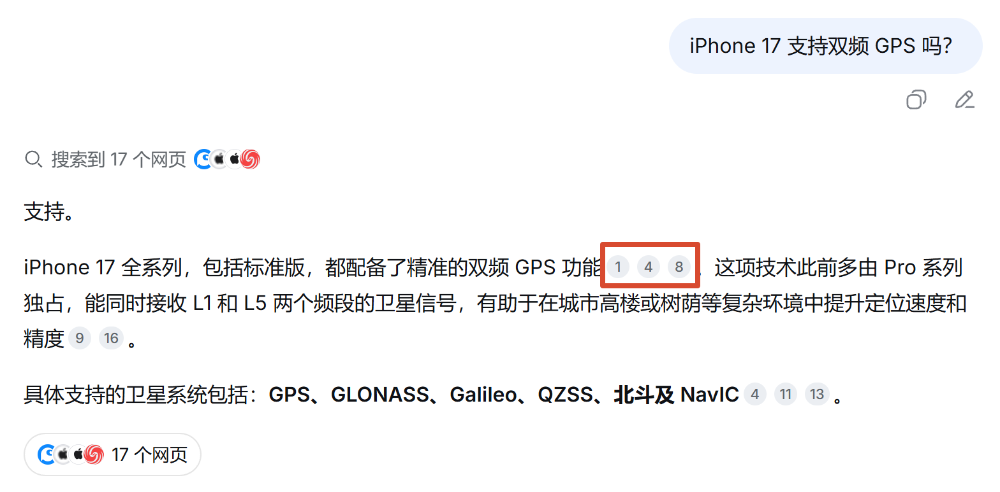

import { DemoShell } from '@/components/helper/demo-shell'
import { SimpleWebSearch } from '../demos/build-agent-4/simple-web-search'
import { WebSearch } from '../demos/build-agent-4/web-search'
import { WebSearchWithTime } from '../demos/build-agent-4/web-search-with-time'
import { WebSearchWithReferences } from '../demos/build-agent-4/web-search-with-references'

截至上篇，我们完成了 Agent Skills 的实现。本章继续扩展 Agent，添加联网搜索功能。

# 网络搜索功能简介

大模型所了解的知识，时效性仅限于它被训练时数据集所截止的时间点；
这个时间点之后发生的事情，大模型无法得知。

大模型厂商可能会提供内置联网搜索的模型，但这种模型的价格非常昂贵，且实现方式和数据格式都太过封闭，并不好用。因此，我们需要通过 Agent 让大模型可在互联网搜索，了解新知识。

# 简单版网络搜索

网络搜索显然是一个工具调用，我们为它命名 `web_search`。

首先需要在后端配备搜索能力。很多服务商都提供了搜索 API，在 Agent 发展的时代，[Tavily](https://www.tavily.com/) （塔维利） 就算一个非常好用的搜索服务。本文接入使用它来达成搜索。

首先，在 Tavily 官网注册账号，免费账号通常每月有 1000 的额度。
注册账号后，我们要把 API Key 记下来，通过环境变量配置到项目中：

```ini
TAVILY_API_KEY = tvly-xxxx
```

然后，安装 Tavily 的 SDK：

```bash
pnpm add @tavily/core
```

接下来注册网络搜索工具 `web_search`，后端代码如下：

```typescript
import 'server-only'

import { tavily } from '@tavily/core'
import { tool } from 'ai'
import { z } from 'zod'

const tavilyClient = tavily({ apiKey: process.env.AI_TAVILY_API_KEY })

const web_search = tool({
  description: '从互联网上搜索信息，就像使用 Google 一样。返回包含摘要的搜索结果列表。',
  inputSchema: z.object({
    query: z.string().min(1)
      .describe('要搜索的关键词或问题，尽量简短、明确。'),
    topic: z.enum(['general', 'news', 'finance']).optional()
      .describe('搜索主题。一般场景用 general；新闻用 news；财经信息用 finance。'),
    maxResults: z.int().min(1).max(10).optional().default(5)
      .describe('最多返回多少条结果，默认 5。'),
  }),
  execute: async ({ query, topic, maxResults }) => {
    try {
      const response = await tavilyClient.search(query, {
        topic,
        maxResults,
        searchDepth: 'advanced',
        includeAnswer: 'advanced',
        includeRawContent: 'markdown',
        includeFavicon: true,
      })

      return { answer: response.answer, results: response.results }
    } catch (error) {
      return {
        error: error instanceof Error ? error.message : '网络搜索失败，请稍后重试。',
      }
    }
  },
})
```

实际上，`web_search` 工具只需要 `query` 一个参数即可，其它参数都可以省略。
我们使用 Tavily，可以按照 SDK 的规则多提供几个参数，以获得更精确的效果；Tavily 还支持 “爬虫模式”、“研究模式” 等，会返回不同的结果，当然耗时和计费情况也不同。

截止到这里，搜索功能的后端实现已经完成了。

我们注册 `web_search` 工具后，凭借着工具的 `description` 向 AI 告知现在具备联网搜索能力。但是，有时我们可能希望 AI 更积极地使用搜索功能，例如 AI 在充当 “媒体运营” 等角色时，对互联网风向比较敏感，此时可以通过系统提示词进一步来提高 AI 对网络搜索工具的积极性：

```typescript {5}
const result = streamText({
  model: mainModel,
  messages: modelMessage,
  system:
    '如果现有知识不足以回答问题，或是需要较新的更具有时效性信息，或是需要核实当前事实等场景，推荐使用 `web_search` 工具联网搜索。',
  tools: { web_search },
  stopWhen: stepCountIs(10),
})
```

上面这一步是可选的。

前端组件的实现思路是，渲染一个列表，列出各个搜索结果的 URL、标题、摘要；但默认是折叠的，只显示搜索的标题，避免影响美观。
这个实现源码太长，此处给出部分源码：

```tsx
<MessageContent>
  {message.parts.map((part, index) => {
    switch (part.type) {
      case 'tool-web_search': {
        const output = part.output as { error?: string; results?: { title?: string; url?: string }[] }

        return (
          <Tool defaultOpen={false} key={`${message.id}-${index}`}>
            <ToolHeader state={part.state} title="联网搜索" type={part.type} />
            <ToolContent>
              {part.state === 'input-streaming' && <div>正在搜索相关网页...</div>}
              {part.errorText && <div>{part.errorText}</div>}
              {output?.error && <div>{output.error}</div>}

              {output?.results?.length ? (
                output.results.map((result, resultIndex) => (
                  <div key={result.url ?? resultIndex}>
                    <a href={result.url} rel="noreferrer" target="_blank">
                      {result.title || result.url}
                    </a>
                  </div>
                ))
              ) : (
                part.state === 'output-available' && !output?.error && <div>没有找到相关结果。</div>
              )}
            </ToolContent>
          </Tool>
        )
      }
    }
  })}
</MessageContent>
```

这样便实现完成了，示例如下：

<DemoShell rerender>
  <SimpleWebSearch />
</DemoShell>

使用默认提供的提示词，发送给 AI 即可；
AI 遇到这种时效性新闻的问题，必然会触发网络搜索功能，根据返回的结果总结回答并输出给用户。

# 完整版网络搜索

上面的示例中，我们使用了 `web_search` 调用了 Tavily 的网络搜索 API，像我们使用 Google 或百度一样，根据大模型输出的搜索关键词，得到一个结果列表并回传给大模型。

但是，结果列表中只包含网页的 **摘要**，并不包含网页的完整正文。
如果某个结果的内容高度吻合关键字，但摘要不足以回答问题，那么便需要完整访问这个搜索结果，获取它的完整页面内容。

通常，Agent 如果想读取某个 URL 的内容，它可以通过 `fetch` 直接拉取 HTML 源文件，但这种方式会得到大量 HTML 标签、脚本代码等无关内容，会导致分散大模型的注意力并浪费大量 Token。

好在 Tavily 提供了 “网页内容提取” API，它专为解决这个需求而设计，它可以尽可能从网页中提取有用的 “正文内容”，取代 `fetch`、`curl` 等工具。

---

接下来，通过代码来接入此功能，我们先注册这个工具：

```typescript
import 'server-only'

import { tavily } from '@tavily/core'
import { tool } from 'ai'
import z from 'zod'

const tavilyClient = tavily({ apiKey: process.env.AI_TAVILY_API_KEY })

export const web_extract = tool({
  description:
    '提取一个或多个网页的正文内容。适合在已知 URL 时读取完整页面，或在网络搜索摘要不足时继续获取原文。',
  inputSchema: z.object({
    urls: z.array(z.url()).min(1).max(5).describe('要提取内容的网页 URL，最多 5 个。'),
    query: z
      .string()
      .trim()
      .min(1)
      .optional()
      .describe('可选。仅提取与该问题相关的内容片段；不传时提取完整正文。'),
    extractDepth: z
      .enum(['basic', 'advanced'])
      .optional()
      .default('basic')
      .describe('提取深度。普通网页用 basic；复杂网页或表格用 advanced。'),
  }),
  execute: async ({ urls, query, extractDepth }) => {
    try {
      const response = await tavilyClient.extract(urls, {
        query,
        extractDepth,
        format: 'markdown',
      })

      return {
        results: response.results.map(result => ({
          title: result.title,
          url: result.url,
          content: result.rawContent,
        })),
        failedResults: response.failedResults,
      }
    } catch (error) {
      return {
        error: error instanceof Error ? error.message : '网页内容提取失败，请稍后重试。',
      }
    }
  },
})
```

可以注意到，代码中我们允许大模型提供 `urls`、`query`、`extractDepth` 这三个参数；
实际上其中最关键的是 `urls`，其它几项都是选填的，提供多个参数可以更有助于定位关键词。

定义好工具后，我们更新系统提示词和工具列表，让 Agent 接入 `web_extract` 工具：

```typescript {21-23}
import 'server-only'

import {
  convertToModelMessages,
  createUIMessageStreamResponse,
  stepCountIs,
  streamText,
  toUIMessageStream,
  type UIMessage,
} from 'ai'

import { mainModel } from '@/lib/agent/models'

export async function POST(request: Request) {
  const { messages } = (await request.json()) as { messages: UIMessage[] }
  const modelMessage = await convertToModelMessages(messages)

  const result = streamText({
    model: mainModel,
    messages: modelMessage,
    system:
      '如果现有知识不足以回答问题，或是需要较新的更具有时效性信息，或是需要核实当前事实等场景，推荐使用 \`web_search\` 工具联网搜索。如果搜索结果的摘要不足以回答问题，可使用 \`web_extract\` 工具提取相关网页的正文内容。',
    tools: { web_extract, web_search },
    stopWhen: stepCountIs(10),
  })

  return createUIMessageStreamResponse({
    stream: toUIMessageStream({ stream: result.stream }),
  })
}

```

这样我们便完成了较为完整支持 “网络搜索” 的 Agent 的后端。

因为本次新增了 `web_extract` 工具调用，因此前端需要配套提供 “网页提取” 这个组件。
在大部分 Agent 中，这个步骤都被渲染为一行文字：`已读取 “XXX 网站标题”`，因为通过 Tavily 读取网页正文并传给大模型这个步骤是后台完成的，没什么特别需要向用户展示的，此组件的前端实现本文省略。

最终，我们得到了一个支持网络搜索和页面提取的 Agent，实现如下：

<DemoShell rerender>
  <WebSearch />
</DemoShell>

# 优化思路：添加当前日期

通常，网络搜索的关键词可能会涉及到时效性。例如：用户询问 “这个月的新闻”，此时 AI 大模型可能会把它训练数据中最晚出现的时间当作最新的时间，从而提供了错误的搜索时间。

有两种思路：

1. 直接在系统提示词中，添加当前日期时间，例如：`现在是 2026 年 8 月 1 日`；
2. 同时注册一个 “获取当前时间 `get_current_time`” 工具，并在系统提示词中告知 AI 时效性的问题需要先调用工具获取现在的日期时间；
   可以这样写：`在使用 "web_search" 工具时，如果搜索具有时效性的消息，可先使用 "get_current_time" 工具获取当前时间，再基于该时间组织搜索词，避免输入错误的日期。`

此处给出第二种方式的实现示例：

<DemoShell rerender>
  <WebSearchWithTime />
</DemoShell>

可以发送我预设的提问测试以下，现在 AI 会先获取当前时间，确保查询的日期正确。

> 通常，不建议把当前日期时间通过系统提示词或其它方式硬编码到上下文中。
>
> 因为，AI 大模型厂商提供的 “prompt 缓存” 遵循前缀匹配，系统提示词中任何内容的不同，都会导致前缀匹配失效，从而无法缓存；这部分不确定的内容更适合通过工具调用来暴露给 AI。

# 优化思路：输出结果时添加引用

以下是一张 DeepSeek 的使用截图：



可以看出，启用网络搜索时，Agent 较好的做法是在回答正文中，通过 “引文” 标记方式，把来源的链接标注出来，这样更方便用户寻找结果的准确来源。

GPT、DeepSeek 等网页版是闭源的；我们可以通过其他开源 Agent 来学习实现方式。本文参考 [OpenWebUI](https://github.com/open-webui/open-webui)、[Kelivo](https://github.com/chevey339/kelivo)、[CherryStudio](https://github.com/cherryhq/cherry-studio) 等开源 Agent 的实现方式。

---

首先，如果想让 AI 根据网页搜索结果，给出内容的出处，那么必须有一种方法来对搜索结果进行 **唯一标识**；因此，我们需要在 “获取搜索结果” 这一步，就给搜索结果打上唯一标识符。

也就是说，我们需要更改 `web_search` 工具的代码，在返回列表时，给每个列表项加上一个唯一标识符；这个标识符可以根据结果项的 URL 或者标题取哈希，也可以使用随机 ID。

本文示例使用随机 ID，修改工具代码如下：

```typescript {3,8,32}
import { tavily } from '@tavily/core'
import { tool } from 'ai'
import { customAlphabet } from 'nanoid'
import z from 'zod'

const tavilyClient = tavily({ apiKey: process.env.AI_TAVILY_API_KEY })

const createResultId = customAlphabet('0123456789abcdef', 8)

export const web_search = tool({
  description: '从互联网上搜索信息，就像使用 Google 一样。返回包含摘要的搜索结果列表。',
  inputSchema: z.object({
    query: z.string().trim().min(1).describe('要搜索的关键词或问题，尽量简短、明确。'),
    topic: z
      .enum(['general', 'news', 'finance'])
      .optional()
      .describe('搜索主题。一般场景用 general；新闻用 news；财经信息用 finance。'),
    maxResults: z.int().min(1).max(10).optional().default(5).describe('最多返回多少条结果，默认 5'),
  }),
  execute: async ({ query, topic, maxResults }) => {
    try {
      const response = await tavilyClient.search(query, {
        topic,
        maxResults,
        searchDepth: 'advanced',
        includeAnswer: 'advanced',
      })

      return {
        answer: response.answer,
        results: response.results.map(result => ({
          id: createResultId(),
          title: result.title,
          url: result.url,
          content: result.content,
          publishedDate: result.publishedDate,
          favicon: result.favicon,
        })),
      }
    } catch (error) {
      return { error: error instanceof Error ? error.message : '网络搜索失败，请稍后重试。' }
    }
  },
})
```

上述示例代码中，为每个搜索结果项添加了长度为 8 的十六进制 ID。
此外，这里还提取了 `favicon`，用于在正文中显示，脚注如果带上 Icon 看上去会更美观。

---

然后，需要让 AI 根据搜索结果列表中的 ID，在中文中把引用搜索结果的正文部分用这个 ID 标注出来。

标注需要使用一个特殊语法，开发者提前约定好，后续通过代码来提取并渲染即可。
参考开源项目中的提示词，大致如下：

::: code-group

```plaintext [CherryStudio]
<citations>
When a statement in your answer is based on a web_search, web_fetch, kb_search, or kb_read result, append a citation marker immediately after that statement: [cite:ID], where ID is the exact `id` field of the supporting result item.

- Example: "Cherry Studio 2.0 entered beta in May. [cite:3f2a1b9c-2]"
- Chain markers when several results support one statement: [cite:3f2a1b9c-1][cite:7d4e0a51-3]
- Copy ids exactly as returned by the tool. Never invent, renumber, or reuse ids from other results.
- Do not add a "References" or "Sources" section at the end — the app renders citations from the inline markers.
- Statements from your own knowledge take no marker.
</citations>
```

```plaintext [Kelivo]
<citations>
When a statement in your answer is based on a search_web result, append a citation marker immediately after that statement: [cite:id], where id is the exact `id` field of the supporting result item.

- Example: "The event took place yesterday afternoon. [cite:a1b2c3]"
- Chain markers when several results support one statement: [cite:a1b2c3][cite:d4e5f6]
- Copy ids exactly as returned by the tool. Never invent, renumber, or reuse ids from other results.
- Place markers inline right after the supported statement (after its punctuation). Do not collect them at the end of the response, and do not add a "References" or "Sources" section — the app renders citations from the inline markers.
- Statements from your own knowledge take no marker.
</citations>
```

:::

可以看出：

- 这些工具都要求基于搜索结果的正文内容，末尾使用 `[cite:ID]` 的格式来标注；
- CherryStudio 的 ID 会带有序号，例如 `3f2a1b9c-2` 这个后面的 `-2` 就表示是搜索结果列表中的第 2 项，如果在页面的标注组件上渲染序号，这会很有用，Kelivo 的 ID 没有序号；
- Kelivo 的提示词避免 AI 在正文末尾再加一块 “参考” 或 “来源” 章节；
- 这两份提示词大体上差不多，可能其中某一份是基于另一份改写的。

<br />

我们基于这两份提示词，构造一套全中文的更完整的提示词：

```plaintext
如果现有知识不足以回答问题，或是需要较新的更具有时效性信息，或是需要核实当前事实等场景，推荐使用 `web_search` 工具联网搜索。
如果搜索结果的摘要不足以回答问题，可使用 `web_extract` 工具提取相关网页的正文内容。

当答案中的语句基于 `web_search` 结果时，请在该语句之后立即附加引文标记：[cite:ID]，其中 ID 是支持结果项的确切 `id` 字段：
- 例如：“苹果 WWDC 大会将于 6 月份召开。 [cite:3f2a1b9c]”；
- 某句话如果有多条引文，请把标记串写： “[cite:3f2a1b9c][cite:7d4e0a51]”；
- 完全复制工具返回的 ID，切勿发明、重新编号或重复使用其他结果中的 ID；
- 不要在末尾添加 “参考文献” 或 “来源” 部分，应用程序会呈现来自内联标记的引用；
- 根据你自己的知识做出的陈述无需任何标记。
```

此外，我们使用上一章节中第一种方式，直接将当前时间写入系统提示词中，减少一次工具调用：

```plaintext
...(上文省略)

当前日期是： XXXX年 X月 X日。
```

代码如下：

```typescript
import 'server-only'

import {
  convertToModelMessages,
  createUIMessageStreamResponse,
  stepCountIs,
  streamText,
  toUIMessageStream,
  type UIMessage,
} from 'ai'
import dayjs from 'dayjs'
import { tagTemplate } from 'omn'

import { mainModel } from '@/lib/agent/models'
import { web_extract } from '../skill-web-extract'
import { web_search } from '../skill-web-search'

dayjs.locale('zh-cn')

export async function POST(request: Request) {
  const { messages } = (await request.json()) as { messages: UIMessage[] }
  const modelMessage = await convertToModelMessages(messages)

  const system = tagTemplate`
    如果现有知识不足以回答问题，或是需要较新的更具有时效性信息，或是需要核实当前事实等场景，推荐使用 \`web_search\` 工具联网搜索。
    如果搜索结果的摘要不足以回答问题，可使用 \`web_extract\` 工具提取相关网页的正文内容。

    当前日期： ${dayjs().format('YYYY年 M月 D日')}。

    当答案中的语句基于 \`web_search\` 结果时，请在该语句之后立即附加引文标记：[cite:ID]，其中 ID 是支持结果项的确切 \`id\` 字段：
    - 例如：“苹果 WWDC 大会将于 6 月份召开。 [cite:3f2a1b9c]”；
    - 某句话如果有多条引文，请把标记串写： “[cite:3f2a1b9c][cite:7d4e0a51]”；
    - 完全复制工具返回的 ID，切勿发明、重新编号或重复使用其他结果中的 ID；
    - 不要在末尾添加 “参考文献” 或 “来源” 部分，应用程序会呈现来自内联标记的引用；
    - 根据你自己的知识做出的陈述无需任何标记。
  `

  const result = streamText({
    model: mainModel,
    messages: modelMessage,
    system,
    tools: { web_extract, web_search },
    stopWhen: stepCountIs(10),
  })

  return createUIMessageStreamResponse({
    stream: toUIMessageStream({ stream: result.stream }),
  })
}
```

这样就实现了让 AI 在回答中，根据网络搜索的结果，在正文中标注出引用来源 ID。

---

接下来，我们需要在 UI 组件中将上述 `[cite:xxxxxxxx]` 标记渲染为 “来源标记”。

在我们的渲染流程中，消息正文 Markdown 会直接传给 `<Streamdown>` 组件进行渲染；这个过程中，如果需要对某些特定语法进行特殊渲染，我们需要利用 `remark` 的定制功能，也就是自己开发一套处理 `[cite:xxxxxxxx]` 标记的 `remark` 插件。

通过以下方式，向 Streamdown 中添加 `remark` 插件代码：

```tsx {9,12}
import { defaultRemarkPlugins, Streamdown } from 'streamdown'

function remarkCitations() {
  // remark 插件代码
  // ...
}

function MessageResponseWebSearch() {
  const remarkPlugins = [...streamdownRemarkPlugins, remarkCitations]

  return (
    <Streamdown remarkPlugins={remarkPlugins} />
  )
}
```

作为渲染 Markdown 的组件，它不能只接受 Markdown 内容，因为需要知道搜索结果的 Icon、标题、URL 信息，同样，这些信息也要透传给我们开发的 `remark` 插件；因此，需要改写代码以透传这些参数：

```tsx {11,20,24}
import { defaultRemarkPlugins, Streamdown } from 'streamdown'

/** 单条网络搜索结果项 */
interface WebSearchCitation {
  id: string
  title: string
  url: string
  favicon?: string
}

function remarkCitations(citations: Record<string, WebSearchCitation>) {
  // remark 插件代码，可通过参数 citations 访问所有搜索结果项键值对
  // ...
}

function MessageResponseWebSearch(props: { citations: Record<string, WebSearchCitation> }) {
  const { citations } = props
  const remarkPlugins = [
    ...streamdownRemarkPlugins,
    [remarkCitations, { citations }],
  ]

  return (
    <Streamdown remarkPlugins={remarkPlugins} />
  )
}
```

这里 `remark` 插件如果需要传入参数，则写成数组的形式，参数作为第二个元素即可，类似于 Webpack 插件的传参方式。

接下来，我们实现 `remarkCitations` 这个插件函数：

::: code-group

```tsx [remarkCitations]
const citationPattern = /\[cite:([a-zA-Z0-9_-]+)\]/g

function remarkCitations({ citations }: Record<string, WebSearchCitation>) {
  return function visitTree(tree: MarkdownNode | undefined) {
    function visit(node: MarkdownNode | undefined) {
      // 跳过代码块等需要 “保持原样” 的部分
      if (!node?.children || ['code', 'html', 'inlineCode', 'link'].includes(node.type)) {
        return
      }

      node.children = node.children.flatMap(child => {
        // 只处理最终被展平的纯文本内容，且需要匹配正则表达式
        if (child.type === 'text' && child.value?.match(citationPattern)) {
          // 处理 [cite:xxxxxxxx] 标记，处理为特殊标签
          return splitCitationText(child.value, citations)
        }

        // 递归处理
        visit(child)

        return child
      })
    }

    // 递归处理
    visit(tree)
  }
}
```

```tsx [splitCitationText]
const citationPattern = /\[cite:([a-zA-Z0-9_-]+)\]/g

function splitCitationText(value: string, citations: Record<string, WebSearchCitation>): MarkdownNode[] {
  const nodes: MarkdownNode[] = []
  let lastIndex = 0

  for (const match of value.matchAll(citationPattern)) {
    const matchIndex = match.index ?? 0
    const id = match[1]

    if (matchIndex > lastIndex) {
      nodes.push({ type: 'text', value: value.slice(lastIndex, matchIndex) })
    }

    const citation = citations[id]
    nodes.push(
      citation
        ? {
            data: {
              hName: 'citation',
              hProperties: {
                href: citation.url,
                title: citation.title ?? '',
                favicon: citation.favicon ?? '',
              },
            },
            type: 'citation',
          }
        : { type: 'text', value: `[${id}]` }
    )
    lastIndex = matchIndex + match[0].length
  }

  if (lastIndex < value.length) {
    nodes.push({ type: 'text', value: value.slice(lastIndex) })
  }

  return nodes
}
```

```tsx [类型 MarkdownNode (可用 any 代替)]
// 可用 any 代替
type MarkdownNode = {
  children?: MarkdownNode[]
  data?: { hName?: string }
  title?: string
  type: string
  url?: string
  value?: string
}
```

:::

上述代码中，`remarkCitations` 遍历 Markdown 结构，查找匹配 `[cite:xxxxxxxx]` 格式的字符串；`splitCitationText` 将特定字符串格式渲染为组件。
通过从 `citations` 中提取对应 ID 的链接对象，提取其中的链接、标题等内容，构造为：

```tsx
<citation url={url} title={title} favicon={favicon}></citation>
```

这里的 `<citation>` 是我们的自定义元素，不能直接使用它。
接下来，我们通过 Streamdown 的自定义组件渲染功能，把 `<citation>` 渲染为一个超链接标签：

```tsx {3-9,15,21-22}
import { defaultRemarkPlugins, Streamdown, type StreamdownProps } from 'streamdown'

function Citation(props: WebSearchCitation) {
  return (
    <a href={props.url}>
      
    </a>
  )
}

function MessageResponseWebSearch(props: { citations: Record<string, WebSearchCitation> }) {
  const { citations } = props
  const remarkPlugins = [
    ...streamdownRemarkPlugins,
    [remarkCitations, { citations }],
  ]

  return (
    <Streamdown
      remarkPlugins={remarkPlugins}
      components={{ citation: Citation } as NonNullable<StreamdownProps['components']>}
      allowedTags={{ citation: ['url', 'title', 'favicon'] }}
    />
  )
}
```

此处把 `<citation>` 这个自定义标签通过 `<Citation>` 组件渲染，同时配置了 `allowedTags`，让它通过 Streamdown 的白名单。

这样以来，Streamdown 这一部分便可以正确渲染 `[cite:xxxxxxxx]` 这种标记为超链接。
但是，我们必须把搜索结果列表注入给 Streamdown 组件才行，下一步便实现这个步骤。

---

在一轮 AI 对话中，联网搜索工具调用和搜索结果的输出是在分布不同的消息体中的，这里需要做的是：让文本渲染组件能访问之前的工具调用所返回的数据

比较简单的思路是这样：

1. 在前端拿到对话数据时，设置一个存储对象，汇总所有网络搜索工具调用的结果，并按照键值对的方式存储；
2. 让 Streamdown 组件可以访问这个存储对象。

简化版的实现代码如下：

::: code-group

```tsx {7,19-21} [前端组件]
import { useChat } from '@ai-sdk/react'
import { useMemo } from 'react'

function Chat() {
  const { messages } = useChat({/* ... */})

  const citations = useMemo(() => getSearchCitations(messages), [messages])

  return (
    <Conversation>
      <ConversationContent>
        {messages.map((message, messageIndex) => (
          <Message from={message.role} key={message.id}>
            <MessageContent>
              {message.parts.map((part, index) => {
                switch (part.type) {
                  case 'text':
                    return (
                      <MessageResponseWebSearch citations={citations}>
                        {part.text}
                      </MessageResponseWebSearch>
                    )

                  case 'tool-web_extract':
                    return <ToolCallWebExtract key={`${message.id}-${index}`} part={part} />

                  case 'tool-web_search':
                    return <ToolCallWebSearch key={`${message.id}-${index}`} part={part} />

                  default:
                    return null
                }
              })}
            </MessageContent>
          </Message>
        ))}
      </ConversationContent>
    </Conversation>
  )
}
```

```typescript [函数 getSearchCitations 实现]
import { type UIMessage, type ToolUIPart } from 'ai'

function getSearchCitations(messages: UIMessage[]): Record<string, WebSearchCitation> {
  const citations: Record<string, WebSearchCitation> = {}

  for (const message of messages) {
    for (const part of message.parts) {
      if (part.type !== 'tool-web_search') continue

      const output = (part as ToolUIPart).output
      if (!output || typeof output !== 'object' || !('results' in output)) continue

      const results = output.results
      if (!Array.isArray(results)) continue

      for (const item of results) {
        if (!item || typeof item !== 'object') continue

        const result = item as Record<string, unknown>
        if (typeof result.id !== 'string' || typeof result.url !== 'string') continue

        citations[result.id] = {
          favicon: typeof result.favicon === 'string' ? result.favicon : undefined,
          id: result.id,
          title: typeof result.title === 'string' ? result.title : undefined,
          url: result.url,
        }
      }
    }
  }

  return citations
}
```

:::

这样以来，在消息列表处，我们实现了将所有网络搜索结果列表合并为对象，并注入给每个消息正文组件；
而消息正文组件检测到 `[cite:xxxxxxxx]`，便会从根据注入的数据中提取 URL、标题、Icon，渲染为标签。

---

完成了 以上步骤，最终实现出来如下（经过了美化）：

<DemoShell rerender>
  <WebSearchWithReferences />
</DemoShell>

你可以点击发送，并查看渲染结果，查看其中指向原始来源的链接按钮。
