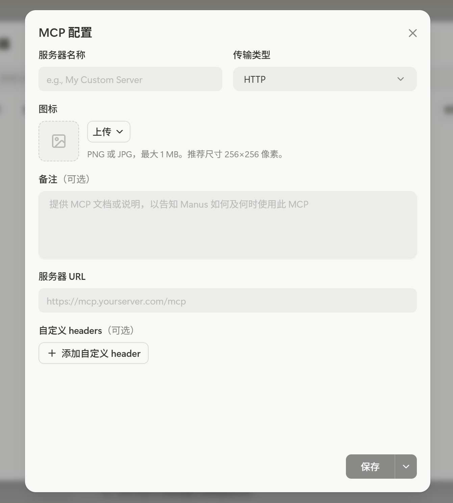
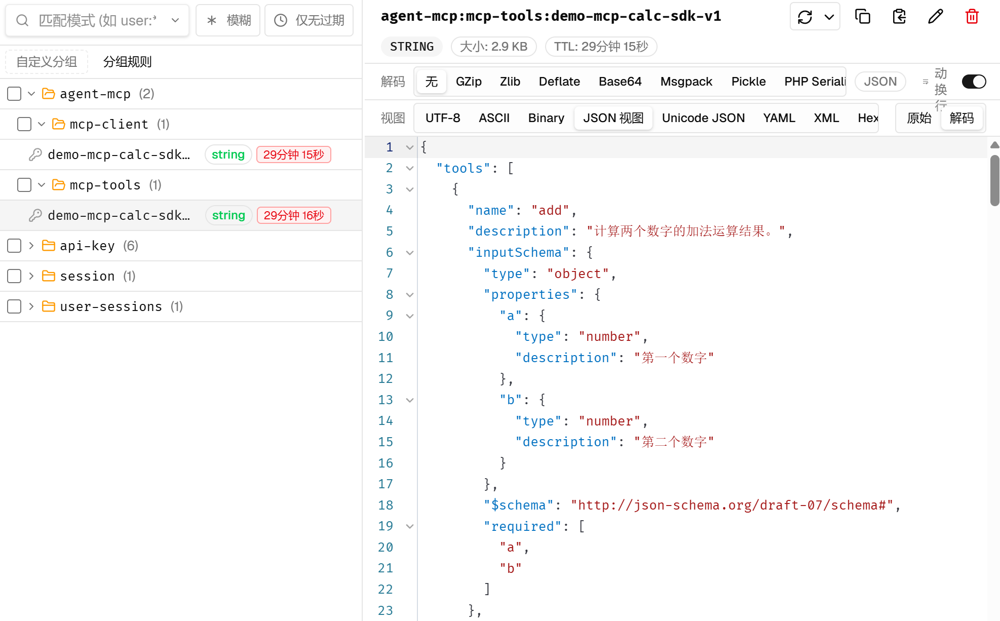

import { DemoShell } from '@/components/helper/demo-shell'
import { McpV1Config, McpServersAgent } from '../demos/build-agent-5/mcp-agent'
import { CalcAgent } from '../demos/build-agent-5/calc-agent'

截至上篇，我们实现了 Agent 常见的 Agent Skills、搜索等功能。
如果想进一步扩展 Agent 与外部的交互能力，那么有必要集成 MCP 能力。

# MCP 介绍

MCP 全称 “Model Context Protocol （模型上下文协议）”，可以理解为给 AI 大模型使用的 “来自外部的工具”。

这里用一个最直白的例子来介绍 MCP：
假设百度地图提供 MCP 服务器，那么，Agent 的使用者可以接入这个 MCP 服务，接入后，Agent 便能访问百度地方提供的一系列工具，例如 “查询某地经纬度坐标”、“查询某地附近交通状况” 等等。

---

Agent 通常通过以下方式接入 MCP：

- 本地运行的 Agent，例如 Claude Code、Hermes，我们可以把 MCP 配置在 Agent 内，每次 Agent 启动时自动通过命令行和参数启动相关的 MCP 服务，此时 Agent 使用 stdio 的方式和 MCP 通讯；
  stdio 是一种 IPC 进程间通讯，因此必须在 Agent 运行的机器上运行 MCP 服务器，才能用这种方式接入；
- 同样，有些服务商提供了基于 Web 的 MCP 服务器，Agent 用户可以远程接入这些 MCP，此时可以使用 OAuth 或者 Bearer 的方式鉴权和计费；
  远程 MCP 有几种通讯格式：
  - 旧版 HTTP + SSE，需使用 GET 请求产生 SSE，然后再用 POST 上传数据，已近乎废弃；
  - 流式 HTTP，同时用到 GET、POST、DELETE 请求；
  - 新版流式 HTTP，发布于 2026 年 7 月 28 日，只用到 POST 请求，响应可以是 SSE 流或者 JSON。

也就是说，对于 Agent 来说，它可以通过 stdio 的方式接入 **本地** 的 MCP 服务器，也可以通过流式 HTTP 或 SSE 接入互联网上的 MCP 服务器。
MCP SDK 对上面各种格式均提供支持，但 v2 版本开始，最老旧的 HTTP + SSE 不再支持。

---

Node.js 可以通过 MCP SDK 来实现 MCP 服务器。

本文开始撰写后，此 SDK 发布了 v2 版本（2026 年 7 月末），具体区别如下：

- v1 版本只有 `@modelcontextprotocol/sdk` 这个一个包；
  官方明确表示，它不会支持 2026-07-28 的 MCP 规范；
- v2 版本服务端使用 `@modelcontextprotocol/server`，客户端使用 `@modelcontextprotocol/client`。

本文将介绍以上所有集成方式；但不推荐再使用 v1 版本。

`mcp-handler` 是由 Vercel 开发的，用于在 Next.js、Nuxt.js 中快速集成 MCP 功能的 SDK，它更适合 Serverless 环境；MCP SDK 是它的依赖项；也因此对于 MCP SDK 的 v1、v2 版本，它也有与之匹配的版本。

本文也将介绍 `mcp-handler` 的用法，同样包含 v1、v2 版本；但不推荐再使用 v1 版本。

# 使用 MCP SDK v1 提供 MCP 服务

::: info 建议使用新版本

MCP SDK 已于 2026 年 7 月末发布 v2 版本，它适配更新、更规范的 MCP 协议。
不建议使用 v1 版本。

:::

本文使用 “计算器” 作为示例 MCP，帮助 AI 大模型实现四则运算。

首先，安装 SDK 和 `zod`：

```bash
pnpm add @modelcontextprotocol/sdk zod
```

`@modelcontextprotocol/sdk` 的只提供了 “启动 MCP 服务器，开启监听” 这种方式。
但是，在 Next.js 项目中执行，我们不希望额外管理 Next.js 进程之外的进程；
因此，本章节的示例 Demo 后端代码都是让 MCP 服务器的存活周期保持在单次请求之内，也就是说：**请求进来就开启 MCP 服务器，处理完请求，返回响应后，就关闭 MCP 服务器。**

---

首先，后端中我们创建 MCP 服务器：

```typescript
import { McpServer } from '@modelcontextprotocol/sdk/server/mcp.js'

const server = new McpServer(
  { name: 'mcp-calc-http', version: '1.0.0' },
  {
    instructions:
      '这是一个计算器 MCP 服务，提供 add、subtract、multiply、divide 四个工具，用于计算两个数字的四则运算。遇到明确的数学计算请求时，优先调用对应工具而不是自行心算。调用 divide 时必须确保除数不为 0；如果用户要求除以 0，应直接告知该操作无效。',
  }
)
```

第一个参数是不可省略的元数据，包含了 MCP 的唯一标识符、版本号等；第二个参数是可选的元数据，上述示例中给出了一段介绍文本 `instructions`。

**MCP 协议明确表示：字段 `instructions` 是可选的，它描述如何使用 MCP 服务器及其功能，帮助大模型理解可用的工具、资源等；客户端可以将它加入系统提示词。**也就是说，开发者可以让 Agent 读取它并加入系统提示词，但这不是必须的。

目前 Codex、Claude Code 等 Agent 都会读取 `instructions` 并把它的内容组织进系统提示词中；本文实现 Agent 时也会参考此做法。

<br />

创建服务器对象后，下一步是向服务器实例上注册工具。代码如下：

::: code-group

```typescript [加法 add]
import z from 'zod'

server.registerTool(
  'add',
  {
    description: '计算两个数字的加法运算结果。',
    inputSchema: z.object({
      a: z.number().describe('第一个数字'),
      b: z.number().describe('第二个数字'),
    }),
    outputSchema: z.object({
      result: z.number().describe('计算结果'),
      expression: z.string().describe('可读的表达式'),
    }),
  },

  async ({ a, b }) => {
    const result = a + b
    // 这里给负数加上括号，例如将 5 + -3 优化为 5 + (-3)
    const _a = a >= 0 ? a : `(${a})`
    const _b = b >= 0 ? b : `(${b})`

    return { result, expression: `${_a} + ${_b} = ${result}` }
  },
)
```

```typescript [减法 subtract]
import z from 'zod'

server.registerTool(
  'subtract',
  {
    description: '计算两个数字的减法运算结果。',
    inputSchema: z.object({
      a: z.number().describe('第一个数字'),
      b: z.number().describe('第二个数字'),
    }),
    outputSchema: z.object({
      result: z.number().describe('计算结果'),
      expression: z.string().describe('可读的表达式'),
    }),
  },

  async ({ a, b }) => {
    const result = a - b
    // 这里给负数加上括号，例如将 5 - -3 优化为 5 - (-3)
    const _a = a >= 0 ? a : `(${a})`
    const _b = b >= 0 ? b : `(${b})`

    return { result, expression: `${_a} - ${_b} = ${result}` }
  },
)
```

```typescript [乘法 multiply]
import z from 'zod'

server.registerTool(
  'multiply',
  {
    description: '计算两个数字的乘法运算结果。',
    inputSchema: z.object({
      a: z.number().describe('第一个数字'),
      b: z.number().describe('第二个数字'),
    }),
    outputSchema: z.object({
      result: z.number().describe('计算结果'),
      expression: z.string().describe('可读的表达式'),
    }),
  },

  async ({ a, b }) => {
    const result = a * b
    // 这里给负数加上括号，例如将 5 * -3 优化为 5 * (-3)
    const _a = a >= 0 ? a : `(${a})`
    const _b = b >= 0 ? b : `(${b})`

    return { result, expression: `${_a} * ${_b} = ${result}` }
  },
)
```

```typescript {18-23} [除法 divide]
import z from 'zod'

server.registerTool(
  'divide',
  {
    description: '计算两个数字的除法运算结果。',
    inputSchema: z.object({
      a: z.number().describe('第一个数字'),
      b: z.number().describe('第二个数字'),
    }),
    outputSchema: z.object({
      result: z.number().describe('计算结果'),
      expression: z.string().describe('可读的表达式'),
    }),
  },

  async ({ a, b }) => {
    if (b === 0) {
      return {
        isError: true,
        content: [{ type: 'text' as const, text: '除数不能为 0。' }]
      }
    }

    const result = a / b
    // 这里给负数加上括号，例如将 5 * -3 优化为 5 * (-3)
    const _a = a >= 0 ? a : `(${a})`
    const _b = b >= 0 ? b : `(${b})`

    return { result, expression: `${_a} / ${_b} = ${result}` }
  },
)
```

:::

我们添加了加减乘除四则运算这四个工具。

这样一来，MCP 服务器的创建、工具的注册这两个最重要的步骤便完成了。

---

MCP SDK 允许我们把服务通过不同的格式对外暴露，例如通过流式 HTTP 和 SSE 等通讯方式，是一种 “适配器” 的模式。

我们使用最普及的流式 HTTP 端点，代码如下：

```typescript [流式 HTTP]
import { WebStandardStreamableHTTPServerTransport } from '@modelcontextprotocol/sdk/server/webStandardStreamableHttp.js'

const transport = new WebStandardStreamableHTTPServerTransport({
  // ↓ 必须开启
  enableJsonResponse: true,

  // 会话 ID 生成器，对于有状态的 MCP，生成器是必须的
  // 本文中的 “计算器工具” 是无状态的，因此留空
  sessionIdGenerator: undefined,
})

await server.connect(transport)

// ==== MCP 服务器准备完成 ====
// 接收到请求时：
const request: Request = someWhere()
const result = await transport.handleRequest(request)
```

在 Next.js 中创建 MCP 服务的端点，需要使用 `route.ts` 自定义路由。

按照 MCP 的规范，一次 MCP 调用格式类似于 JSON-RPC 2.0，传输的对象有很多字段；但我们使用 SDK，可以忽略具体实现，具体的参数提取转换等步骤均由 SDK 包揽。

<br />

然后，我们需要在 POST 请求的处理函数中，完成上述的创建 MCP 服务器实例、注册工具、开启流式 HTTP 适配器，然后调用 `handleRequest()` 函数处理请求并得到结果，随后关闭并销毁这个 MCP 服务器实例。

如果使用流式 HTTP，MCP SDK 提供了一个便利，它的 `handleRequest()` 函数可以同时处理 GET、POST、DELETE 请求，因为 SDK 内部的代码进行了区分；因此我们只需要把这个流程封装为同一个函数，一次性处理三种请求。

这个函数代码如下：

```typescript {24-29}
import { McpServer } from '@modelcontextprotocol/sdk/server/mcp.js'
import { WebStandardStreamableHTTPServerTransport } from '@modelcontextprotocol/sdk/server/webStandardStreamableHttp.js'
import z from 'zod'

async function handleMcpRequest(request: Request) {
  const server = new McpServer(
    { name: 'mcp-calc-http-v1', version: '1.0.0' },
    // 参考上文，此处省略
    { instructions: '...' },
  )

  // 注册 “加减乘除” 四个工具，参数参考上文，此处省略
  server.registerTool('add',      description, inputSchema, outputSchema)
  server.registerTool('subtract', description, inputSchema, outputSchema)
  server.registerTool('multiply', description, inputSchema, outputSchema)
  server.registerTool('divide',   description, inputSchema, outputSchema)

  const transport = new WebStandardStreamableHTTPServerTransport({
    enableJsonResponse: true,
    sessionIdGenerator: undefined,
  })
  await server.connect(transport)

  try {
    return await transport.handleRequest(request)
  } finally {
    // 请求完成后，销毁服务器
    await server.close()
  }
}
```

然后，使用这个函数处理 GET、POST、DELETE 请求：

```typescript
export { handleMcpRequest as GET, handleMcpRequest as POST, handleMcpRequest as DELETE }
```

这样便完成了在 Next.js 中集成一个流式 HTTP 的 MCP 服务端点。

本项目已经按照上述代码实现好了，位于 `/api/agent/demo/build-agent-5/mcp-calc-sdk-v1` 这个路径。

::: warning 旧版本的 400 问题

客户端可能会使用 JsonRPC 的发现机制，在此端点尝试 "2026-07-28" 的新版格式。

MCP SDK v1 不支持此版本，这会产生报错：

```json
{
  "jsonrpc": "2.0",
  "error": {
    "code": -32000,
    "message": "Bad Request: Unsupported protocol version: 2026-07-28 (supported versions: 2025-11-25, 2025-06-18, 2025-03-26, 2024-11-05, 2024-10-07)"
  }
}
```

如果客户端能智能回退 MCP 协议版本，那么后续请求还是可以正常完成的。

:::

---

本文中，MCP 服务器是请求级别的，有请求进来后它被创建，请求结束后它被销毁；这也是因为 Next.js 通常被部署于 Serverless 上，它不会持久运行。

如果你的 Next.js 项目以 standalone 方式部署，那么可以对 MCP 服务进行 “实例缓存”，避免它的重复创建销毁。

# 使用 MCP SDK v2 提供 MCP 服务

从上面的代码可以看出，每个 MCP 请求都需要经历 “创建 MCP 服务器实例” → “处理请求” → “销毁 MCP 服务器实例” 的流程，在 Next.js 这种 Serverless 的后端设计中，适用性不强。所以不推荐使用 `@modelcontextprotocol/sdk` 的 v1 方式。

本章节介绍 v2 的创建方式。

v2 使用不同的包名，我们需要先安装它：

```bash
pnpm add @modelcontextprotocol/server zod
```

v2 提供了 `createMcpHandler` 函数，用于创建 MCP 处理器；
我们使用它来创建：

```typescript
import { createMcpHandler, McpServer } from '@modelcontextprotocol/server'
import z from 'zod'

const handler = createMcpHandler(() => {
  const server = new McpServer(
    { name: 'mcp-calc-http-v2', version: '2.0.0' },
    {
      instructions:
        '这是一个计算器 MCP 服务，提供 add、subtract、multiply、divide 四个工具，用于计算两个数字的四则运算。遇到明确的数学计算请求时，优先调用对应工具而不是自行心算。调用 divide 时必须确保除数不为 0；如果用户要求除以 0，应直接告知该操作无效。',
    }
  )

  server.registerTool(
    'add',
    {
      description: '计算两个数字的加法运算结果。',
      inputSchema: z.object({
        a: z.number().describe('第一个数字'),
        b: z.number().describe('第二个数字'),
      }),
      outputSchema: z.object({
        result: z.number().describe('计算结果'),
        expression: z.string().describe('可读的表达式'),
      }),
    },
    async ({ a, b }) => {
      const result = a + b
      // 这里给负数加上括号，例如将 5 + -3 优化为 5 + (-3)
      const _a = a >= 0 ? a : `(${a})`
      const _b = b >= 0 ? b : `(${b})`

      return { result, expression: `${_a} + ${_b} = ${result}` }
    },
  )

  server.registerTool(
    'subtract',
    {
      description: '计算两个数字的减法运算结果。',
      inputSchema: z.object({
        a: z.number().describe('第一个数字'),
        b: z.number().describe('第二个数字'),
      }),
      outputSchema: z.object({
        result: z.number().describe('计算结果'),
        expression: z.string().describe('可读的表达式'),
      }),
    },
    async ({ a, b }) => {
      const result = a - b
      // 这里给负数加上括号，例如将 5 - -3 优化为 5 - (-3)
      const _a = a >= 0 ? a : `(${a})`
      const _b = b >= 0 ? b : `(${b})`

      return { result, expression: `${_a} - ${_b} = ${result}` }
    },
  )

  server.registerTool(
    'multiply',
    {
      description: '计算两个数字的乘法运算结果。',
      inputSchema: z.object({
        a: z.number().describe('第一个数字'),
        b: z.number().describe('第二个数字'),
      }),
      outputSchema: z.object({
        result: z.number().describe('计算结果'),
        expression: z.string().describe('可读的表达式'),
      }),
    },
    async ({ a, b }) => {
      const result = a * b
      // 这里给负数加上括号，例如将 5 * -3 优化为 5 * (-3)
      const _a = a >= 0 ? a : `(${a})`
      const _b = b >= 0 ? b : `(${b})`

      return { result, expression: `${_a} * ${_b} = ${result}` }
    },
  )

  server.registerTool(
    'divide',
    {
      description: '计算两个数字的除法运算结果。',
      inputSchema: z.object({
        a: z.number().describe('第一个数字'),
        b: z.number().describe('第二个数字'),
      }),
      outputSchema: z.object({
        result: z.number().describe('计算结果'),
        expression: z.string().describe('可读的表达式'),
      }),
    },
    async ({ a, b }) => {
      if (b === 0) {
        return {
          isError: true,
          content: [{ type: 'text' as const, text: '除数不能为 0。' }]
        }
      }

      const result = a / b
      // 这里给负数加上括号，例如将 5 * -3 优化为 5 * (-3)
      const _a = a >= 0 ? a : `(${a})`
      const _b = b >= 0 ? b : `(${b})`

      return { result, expression: `${_a} / ${_b} = ${result}` }
    },
  )

  return server
})
```

从代码中可以看出，`createMcpHandler` 将 “创建 `MCPServer` 的过程” 作为参数，在这个 “过程” 中，通过 `server.registerTool()` 依次注册工具，此过程的返回值就是一个 “创建好的 `MCPServer`”；
而 `createMcpHandler` 得到的结果是一个 “`handler`”，我们后续使用的是它，而不再是 `MCPServer`。

接下来，我们把这个 “`handler.fetch`” 作为 GET、POST 的处理函数，代码如下：

```typescript
const handleRequest = handler.fetch

export { handleRequest as GET, handleRequest as POST, handleRequest as DELETE }
```

这样就完成了 MCP 端点的创建，非常简洁。

本项目已经按照上述代码实现好了，位于 `/api/agent/demo/build-agent-5/mcp-calc-sdk-v2` 这个路径。

可以看出，`handler.fetch()` 接管了 MCP 请求的全周期流程，不再需要管理 `MCPServer` 的生命周期，也不再需要通过 `WebStandardStreamableHTTPServerTransport` 等方式显示声明适配器了，这便是它与 v1 间最大的区别。

# Next.js 中使用 `mcp-handler` 提供 MCP 服务

[`mcp-handler`](https://www.npmjs.com/package/mcp-handler) 是 Vercel 开发的，专为 Next.js、Nuxt.js 等 Serverless 框架设计的 MCP 服务工具。

如果你使用 MCP SDK 的新的 v2 版本，或者此前没有集成过 MCP SDK，那么直接安装最新版即可；
如果你使用 MCP SDK v1，那么也必须安装 `mcp-handler` 的 v1 版本。

**请注意，v2 版本不再支持 SSE 格式，只支持流式 HTTP。**

<br />

首先，我们来安装它（v2）：

```bash
pnpm add mcp-handler @modelcontextprotocol/server zod
```

如果你使用 v1 版本，则这样安装：

```bash
pnpm add mcp-handler@^1 @modelcontextprotocol/sdk@^1 zod
```

本文主要介绍 v2 版本用法；v1 版本会有一些区别，也会简单提到。

<br />

以下是 MCP 端点的代码实现：

```typescript
import { createMcpHandler } from 'mcp-handler'
import z from 'zod'

const handler = createMcpHandler(
  server => {
    server.registerTool(
      'add',
      {
        description: '计算两个数字的加法运算结果。',
        inputSchema: z.object({
          a: z.number().describe('第一个数字'),
          b: z.number().describe('第二个数字'),
        }),
        outputSchema: z.object({
          result: z.number().describe('计算结果'),
          expression: z.string().describe('可读的表达式'),
        }),
      },
      async ({ a, b }) => {
        const result = a + b
        // 这里给负数加上括号，例如将 5 + -3 优化为 5 + (-3)
        const _a = a >= 0 ? a : `(${a})`
        const _b = b >= 0 ? b : `(${b})`

        return { result, expression: `${_a} + ${_b} = ${result}` }
      },
    )

    server.registerTool(
      'subtract',
      {
        description: '计算两个数字的减法运算结果。',
        inputSchema: z.object({
          a: z.number().describe('第一个数字'),
          b: z.number().describe('第二个数字'),
        }),
        outputSchema: z.object({
          result: z.number().describe('计算结果'),
          expression: z.string().describe('可读的表达式'),
        }),
      },
      async ({ a, b }) => {
        const result = a - b
        // 这里给负数加上括号，例如将 5 - -3 优化为 5 - (-3)
        const _a = a >= 0 ? a : `(${a})`
        const _b = b >= 0 ? b : `(${b})`

        return { result, expression: `${_a} - ${_b} = ${result}` }
      },
    )

    server.registerTool(
      'multiply',
      {
        description: '计算两个数字的乘法运算结果。',
        inputSchema: z.object({
          a: z.number().describe('第一个数字'),
          b: z.number().describe('第二个数字'),
        }),
        outputSchema: z.object({
          result: z.number().describe('计算结果'),
          expression: z.string().describe('可读的表达式'),
        }),
      },
      async ({ a, b }) => {
        const result = a * b
        // 这里给负数加上括号，例如将 5 * -3 优化为 5 * (-3)
        const _a = a >= 0 ? a : `(${a})`
        const _b = b >= 0 ? b : `(${b})`

        return { result, expression: `${_a} * ${_b} = ${result}` }
      },
    )

    server.registerTool(
      'divide',
      {
        description: '计算两个数字的除法运算结果。',
        inputSchema: z.object({
          a: z.number().describe('第一个数字'),
          b: z.number().describe('第二个数字'),
        }),
        outputSchema: z.object({
          result: z.number().describe('计算结果'),
          expression: z.string().describe('可读的表达式'),
        }),
      },
      async ({ a, b }) => {
        if (b === 0) {
          return {
            isError: true,
            content: [{ type: 'text' as const, text: '除数不能为 0。' }]
          }
        }

        const result = a / b
        // 这里给负数加上括号，例如将 5 * -3 优化为 5 * (-3)
        const _a = a >= 0 ? a : `(${a})`
        const _b = b >= 0 ? b : `(${b})`

        return { result, expression: `${_a} / ${_b} = ${result}` }
      },
    )
  },
  {
    serverInfo: { name: 'mcp-calc-http-next', version: '1.0.0' },
    instructions:
      '这是一个计算器 MCP 服务，提供 add、subtract、multiply、divide 四个工具，用于计算两个数字的四则运算。遇到明确的数学计算请求时，优先调用对应工具而不是自行心算。调用 divide 时必须确保除数不为 0；如果用户要求除以 0，应直接告知该操作无效。',
  }
)
```

可以看出，它的用法大体上和 MCP SDK v2 差不多，但显得更加 “面向过程”，更适合 Serverless 场景。

这个 `handler` 可以用于处理 GET、POST 等请求，因此：

```typescript
export { handler as GET, handler as POST, handler as DELETE }
```

这样就完成了。

本项目已经按照上述代码实现好了，位于 `/api/agent/demo/build-agent-5/mcp-calc-next` 这个路径。

<br />

如果使用的是 v1 版本，还需要 “关掉 SSE”、“关掉 Session ID 生成器”、“显示指定流式 HTTP 端点” 等配置，此时需要为`createMcpHandler()` 添加第三个参数，内容为：

```typescript {4-8}
createMcpHandler(
  {}, // ...
  {}, // ..
  {
    disableSse: true,
    sessionIdGenerator: undefined,
    streamableHttpEndpoint: '/...',
  }
)
```

其中 `streamableHttpEndpoint` 的路径需要和此端点在项目中的路径相同。

# 为 Agent 接入 MCP

上文中，我们只是实现了几个后端的 MCP 服务。
接下来，我们为 Agent 实现 MCP 功能，让这个 Agent 可以接入我们自己的 MCP 服务。

<br />

首先，Agent 往往支持连接到多个 MCP 服务，需要设计为列表格式。
一般来说，除了由 Agent 开发者提供的内置或预配置 MCP 外，Agent 可以允许用户自行填写 URL，以连接到外部 MCP 服务器。

例如下图中所示的是 Manus 的自定义 MCP 的填写框：



因此，我们可以先实现这个用于填写保存 MCP 服务列表的前端组件。

这个表单通常要这样设计：

- 需要一个 “名称” 字段，用于区分和识别；
- 类型如果是 “stdio”，则需要提供启动命令，例如 `npx -y some-mcp`，还可以允许用户填写命令行参数、环境变量等；
  提交后，Agent 的服务器会通过 `npx` 或 `uv` 启动这些服务器，并接入 Agent；
- 类型如果是 “流式 HTTP” 或 “SSE”，则需要提供服务的 URL，还可以允许用户填写请求头等参数。

本文暂不考虑 “stdio” 这种方式。

按照上述格式，设计一个前端组件如下：

<DemoShell rerender>
  <McpV1Config />
</DemoShell>

这是一个列表组件，允许用户增删改 MCP 列表；
其中每项都是有着三个字段的对象，代码非常简单，此处不再赘述。

如果是正式上线的 Agent，通常用户配置的 MCP 存储在数据库里，前端不会暴露任何额外信息；
但本文的示例是无状态的 Agent，因此本文中的实现会将这个列表组件的数据作为组件数据，每次发送消息时，都以明文 JSON 的形式作为 Body 传给 Agent 后端。

因此，这里的实现方式是直接把前端控件里的数据随附消息请求发给后端，代码如下：

```tsx
function Chat() {
  const [mcpServers, setMcpServers] = useState([])

  return (
    <>
      {/* MCP 服务配置控件，源码省略 */}
      <MCPServerConfig mcpServers={mcpServers} setMcpServers={setMcpServers} />

      <PromptInput
        onSubmit={message =>
          // 列表中的 MCP 配置数组 mcpServers
          // 点击发送按钮后，就会随附 mcpServers 数组一起发送
          void sendMessage({ text: message.text }, { body: { mcpServers } })
        }
      >
        {/* ... */}
      </PromptInput>
    </>
  )
}
```

后端使用 Vercel AI SDK 提取这个 `mcpServers` 字段也很简单：

```typescript
// messages 是原来的消息列表，mcpServers 就是前端额外加的内容
const { messages, mcpServers } = (await request.json()) as any
```

上面的前端组件 Demo 中默认的 MCP 服务，前端提交、后端接收，都是这样的结构：

```json
{
  "mcpServers": [
    {
      "name": "mcp-calc-http-v1",
      "url": "https://paperplane.cc/api/agent/demo/build-agent-5/mcp-calc-sdk-v1",
      "transportType": "http"
    }
  ]
}
```

本文使用 Vercel AI SDK 提供的 MCP 连接 Client 进行集成。
接下来是收到消息请求后，处理 MCP 连接的后端代码。

---

连接 MCP 服务需要用到 Vercel AI SDK 提供的 MCPClient。

我们先假设：每次请求进来时，有且仅有上述示例这固定一个 MCP 服务需要使用。
我们初始化一个 MCPClient 处理 MCP，后端代码如下：

```typescript {1,15-22,24-25,34-36}
import { createMCPClient } from '@ai-sdk/mcp'
import {
  convertToModelMessages,
  createUIMessageStreamResponse,
  stepCountIs,
  streamText,
  toUIMessageStream,
  type ToolSet,
  type UIMessage,
} from 'ai'

import { mainModel } from '@/lib/agent/models'

export async function POST(request: Request) {
  const client = await createMCPClient({
    // 这里的参数，使用上面写死的，用作示例
    clientName: 'mcp-calc-http-v1',
    transport: {
      type: 'http',
      url: 'https://paperplane.cc/api/agent/demo/build-agent-5/mcp-calc-sdk-v1',
    },
  })

  // 从 MCP 中获取所有工具，使用 ToolSet 类型，后续不再需要额外转换
  const tools: ToolSet = await client.tools()

  const { messages } = await request.json()
  const modelMessages = await convertToModelMessages(messages)
  const result = streamText({
    model: mainModel,
    messages: modelMessages,
    tools,
    stopWhen: stepCountIs(10),
    onFinish: async () => {
      await client.close()
    },
  })

  return createUIMessageStreamResponse({
    stream: toUIMessageStream({ stream: result.stream }),
  })
}
```

上述代码通过 `await client.tools()` 提取 MCP 的所有工具，直接作为工具列表传入 `streamText()` 即可；
每个 AI 对话轮次结束，在 `onFinish` 回调中将 MCPClient 销毁。

前端组件，直接使用最基础的 “仅支持服务端工具调用” 的 Agent 模板：

<DemoShell rerender>
  <CalcAgent />
</DemoShell>

点击发送预设的消息，即可体验已接入 MCP 的 Agent 是如何调用工具的。

---

我们可以通过工具打印 Agent 发给大模型接口的数据，得到以下内容：

```json
{
  "model": "deepseek-v4-flash",
  "messages": [
    {
      "role": "assistant",
      "content": "你好，我是接入计算器 MCP 的机器人，可为你处理数学计算！"
    },
    {
      "role": "user",
      "content": "计算 128 * 64，并告诉我结果"
    },
    {
      "role": "assistant",
      "content": null,
      "reasoning_content": "The user wants to calculate 128 * 64. I'll use the multiply tool.",
      "tool_calls": [
        {
          "id": "chatcmpl-tool-b5715cd19b55d604",
          "type": "function",
          "function": {
            "name": "multiply",
            "arguments": "{\"a\":128,\"b\":64}"
          }
        }
      ]
    },
    {
      "role": "tool",
      "tool_call_id": "chatcmpl-tool-b5715cd19b55d604",
      "content": "[{\"type\":\"text\",\"text\":\"128 * 64 = 8192\"}]"
    }
  ],
  "tools": [
    {
      "type": "function",
      "function": {
        "name": "add",
        "description": "计算两个数字的加法运算结果。",
        "parameters": {
          "type": "object",
          "properties": {
            "a": {
              "type": "number",
              "description": "第一个数字"
            },
            "b": {
              "type": "number",
              "description": "第二个数字"
            }
          },
          "$schema": "http://json-schema.org/draft-07/schema#",
          "required": [
            "a",
            "b"
          ],
          "additionalProperties": false
        }
      }
    },
    {
      "type": "function",
      "function": {
        "name": "subtract",
        "description": "计算两个数字的减法运算结果。",
        "parameters": {
          "type": "object",
          "properties": {
            "a": {
              "type": "number",
              "description": "第一个数字"
            },
            "b": {
              "type": "number",
              "description": "第二个数字"
            }
          },
          "$schema": "http://json-schema.org/draft-07/schema#",
          "required": [
            "a",
            "b"
          ],
          "additionalProperties": false
        }
      }
    },
    {
      "type": "function",
      "function": {
        "name": "multiply",
        "description": "计算两个数字的乘法运算结果。",
        "parameters": {
          "type": "object",
          "properties": {
            "a": {
              "type": "number",
              "description": "第一个数字"
            },
            "b": {
              "type": "number",
              "description": "第二个数字"
            }
          },
          "$schema": "http://json-schema.org/draft-07/schema#",
          "required": [
            "a",
            "b"
          ],
          "additionalProperties": false
        }
      }
    },
    {
      "type": "function",
      "function": {
        "name": "divide",
        "description": "计算两个数字的除法运算结果。",
        "parameters": {
          "type": "object",
          "properties": {
            "a": {
              "type": "number",
              "description": "第一个数字"
            },
            "b": {
              "type": "number",
              "description": "第二个数字"
            }
          },
          "$schema": "http://json-schema.org/draft-07/schema#",
          "required": [
            "a",
            "b"
          ],
          "additionalProperties": false
        }
      }
    }
  ],
  "tool_choice": "auto",
  "stream": true
}
```

可以看出：接入 MCP 服务器，本质上就是把 MCP 服务器提供的工具列表拿过来，放到大模型的工具列表中，提交给接口。

那么问题来了：

1. 既然本质上是加载 MCP 工具列表，那是不是可以不必每次请求都初始化客户端加载列表，可以进行缓存？
2. 我们创建 MCP 服务器时，提供了一段 `instructions` 文字，这段文字好像并没有被使用到？
3. Agent 往往会接入多个 MCP 服务器，每个 MCP 服务器又会提供多个工具，那工具列表岂不是会特别长，有几十上百个工具都可调用？

接下来挨个解答。

## 后端缓存 MCP 服务器和工具定义

**问题 ①，既然本质上是加载 MCP 工具列表，那是不是可以不必每次请求都初始化客户端加载列表，可以进行缓存？**

如果 Next.js 类项目以 Serverless 模式部署，那么这种做法实际上问题不大，因为项目的存活周期是请求级别的。

如果以 standalone 模式部署，或者是非 Next.js 类项目，那么可以把 MCP 服务器的工具定义序列化为 JSON 格式并通过 Redis 等方式进行缓存；
Vercel AI SDK 在 MCP 缓存方面，提供了相关的 API，但分为两个步骤：

1. 首先 `createMCPClient()` 默认会尝试建立连接以发现 MCP 服务；连接建立成功后，返回的对象的 `initializeResult` 属性可被序列化存储，我们可以将它缓存；后续把缓存数据反序列化为对象，通过 `initialInitializeResult` 参数来初始化 MCPClient，这样就可以跳过建立连接的步骤；
2. 默认获取工具列表是通过 `client.tools()` 来获取，得到的是无法序列化的 JS 对象；
   我们改为通过 `client.listTools()` 便可以得到可序列化的存储的工具定义，它可被缓存；后续把缓存数据反序列化为对象，通过 `client.toolsFromDefinitions()` 来加载，便可以得到和 `client.tools()` 相同的结果。

以下是示例代码：

```typescript {23-24,26-41,43-52}
import { createMCPClient } from '@ai-sdk/mcp'
import {
  convertToModelMessages,
  createUIMessageStreamResponse,
  stepCountIs,
  streamText,
  toUIMessageStream,
  type ToolSet,
  type UIMessage,
} from 'ai'

import { mainModel } from '@/lib/agent/models'

export async function POST(request: Request) {
  const mcpConfig = {
    clientName: 'mcp-calc-http-v1',
    transport: {
      type: 'http',
      url: 'https://paperplane.cc/api/agent/demo/build-agent-5/mcp-calc-sdk-v1',
    },
  }

  // 根据 MCP 服务器配置，提取哈希，用作缓存 Key
  const mcpConfigHash = hash(mcpConfig)

  // MCPClient 相关缓存
  const mcpClientCacheKey = `mcp:server:${mcpConfigHash}`

  const cachedInitializeResult = await redis.getex(mcpClientCacheKey, 'EX', 60 * 60)
  const initialInitializeResult = cachedInitializeResult
    ? JSON.parse(cachedInitializeResult)
    : undefined

  const client = await createMCPClient({
    ...mcpConfig,
    initialInitializeResult,
  })

  if (!initialInitializeResult) {
    await redis.set(mcpClientCacheKey, JSON.stringify(client.initializeResult), 'EX', 60 * 60)
  }

  // MCP 工具列表缓存
  const mcpToolsCacheKey = `mcp:tools:${mcpConfigHash}`
  const cachedToolDefinitions = await redis.getex(mcpToolsCacheKey, 'EX', 60 * 60)
  const toolDefinitions = cachedToolDefinitions
    ? JSON.parse(cachedToolDefinitions)
    : await client.listTools()

  if (!cachedToolDefinitions) {
    await redis.set(mcpToolsCacheKey, JSON.stringify(toolDefinitions), 'EX', 60 * 60)
  }

  const tools: ToolSet = client.toolsFromDefinitions(toolDefinitions)

  const { messages } = await request.json()
  const modelMessages = await convertToModelMessages(messages)
  const result = streamText({
    model: mainModel,
    messages: modelMessages,
    tools,
    stopWhen: stepCountIs(10),
    onFinish: async () => {
      await client.close()
    },
  })

  return createUIMessageStreamResponse({
    stream: toUIMessageStream({ stream: result.stream }),
  })
}
```

这样便可以在客户端多次请求时，缓存工具列表等数据，避免重复的开销；
如下图所示：



这是应用了缓存代码后，本地测试的结果，可见计算器的工具定义数组已被全部缓存。

## MCP 服务器介绍文本注入

**问题 ②，我们创建 MCP 服务器时，提供了一段 `instructions` 文字，这段文字好像并没有被使用到？**

取决于 Agent 开发者如何实现此功能；不使用它，也是一种选择，甚至是更普遍的做法。

既可以将 MCP 服务器的 `instructions` 注入到系统提示词中，这可能有利于 Agent 理解 MCP 服务带来的工具，但是可能也要承担由此带来的注入攻击风险；也可以交由用户选择是否使用，或是否覆写；甚至可以保持现状，忽略 MCP 服务器的 `instructions`。
例如，Kelivo 等工具，就选择完全抛弃 MCP 服务器的 `instructions` 字段。

考虑到用户有可能加载多个 MCP 服务器，Agent 可能也要加载多条 `instructions` 到系统提示词里，因此这段逻辑需要涉及到遍历操作。
这里给出一个简单的示例：

::: code-group

```plaintext [不使用 XML 标签]
你可以按需调用已连接的 MCP 工具。以下是当前已连接的 MCP 服务器名称和说明：

- 名称: 说明文本
- 名称: 说明文本
- 名称: 说明文本
```

```plaintext [使用 XML 标签]
<mcp-servers>
你可以按需调用已连接的 MCP 工具。以下是当前已连接的 MCP 服务器名称和说明：

- 名称: 说明文本
- 名称: 说明文本
- 名称: 说明文本
</mcp-servers>
```

:::

## 处理多个 MCP 下的多组工具

**问题 ③，Agent 往往会接入多个 MCP 服务器，每个 MCP 服务器又会提供多个工具，那工具列表岂不是会特别长，有几十上百个工具都可调用？**

首先，为了区别多个 MCP 服务器下的多组工具，我们需要在工具注册时，对工具的命名进行调整；
一个被广泛使用的实践方式是，使用 `mcp__MCP服务名__工具名`，例如：对于计算器 MCP 服务的加法计算工具，可以将它注册为 `mcp__calculator__add`。

这样以来，即使多个 MCP 服务器注册了相同名称的工具，彼此之间也能正常区分；
此外，Agent 还应当针对同名的 MCP 服务，具备自动检测重复的能力，如果确实不重复，可以在同名的 MCP 后面加上后缀 `-1`、`-2` 这种方式来区别开。

使用统一的 `mcp__` 的另一个好处是，我们可以在前端渲染时设计一套 MCP 专用的组件样式，然后就可以通过工具名称前缀来判断工具调用是不是 MCP 工具，并应用之前准备好的样式。
代码大致如下：

```tsx
import { isToolUIPart, getToolName } from 'ai'

if (isToolUIPart(part) && getToolName(part).startsWith('mcp__')) {
  return <ToolCallMcp part={part} />
}
```

<br />

其次，Agent 并不需要一次性暴露所有工具给大模型。

常见的做法是：准备一个 “完整的工具名称列表”，只列出每个工具的名称，同时提供 “搜索器” 这个工具给大模型，告知大模型先使用 “搜索器” 来检索工具，大模型把意图或工具名传给此工具，此工具返回给大模型指定的工具的详细定义，然后再调用此工具。

Codex、Claude Code、WorkBuddy 等 Agent 都使用这个设计思路，每次只暴露一部分使用频率高内置工具，来自插件、来自 MCP 的工具，都被作为 “延迟加载工具”，默认只对大模型暴露一个名称，而不暴露详细定义；Agent 对大模型提供了一个叫 `tool_search` 或 `search_tool` 的 “搜索器” 工具，大模型可以按需使用它来加载这些外部的工具。

**下一轮对话开始时，被延迟加载的工具也会被添加到工具列表里发给大模型；但是，延迟加载的工具会带有 `"defer_loading": true` 这个属性；大模型计算缓存时，会排除掉工具列表中带有 `"defer_loading": true` 的工具项，因此延迟加载工具虽然在后续对话轮次中修改了工具列表，但是不会影响到缓存。**

Vercel AI SDK 在注册工具时，也支持把 `tool_search` 这个 “搜索器” 提供给大模型；同时，也支持通过 `deferLoading: true` 配置项将工具标注为延迟加载工具。具体原理和实现，系列文章后续会给出详情用法和示例，此处不再赘述。

## 多 MCP 接入 Agent 示例

当 Agent 接入多个 MCP 时，可能需要提取多个 MCP 服务的说明文本并加载多个 MCP 的工具列表。为了避免重复操作，这些加载过程可能会被缓存结果并自动复用。

同样，为了避免工具列表过长的问题，MCP 服务暴露的工具可能会被延迟加载，这需要 Agent 提供配套的延迟加载工具的机制。具体而言由 Agent 开发者而定，本文仅作示例。

以下是一个接入多个 MCP 服务器的 Agent 示例：

<DemoShell rerender>
  <McpServersAgent />
</DemoShell>

其中随机数生成器、计算器，这两个 MCP 都是由本项目内代码实现的；你还可以在工具列表中填入其它互联网上的无鉴权 MCP 服务，只要能连接成功，此 Agent 便可以正确加载外部工具。
