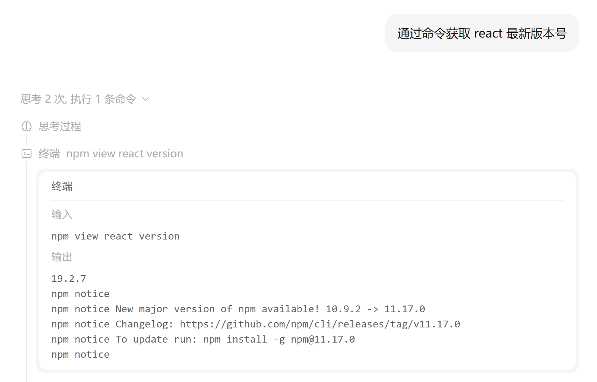
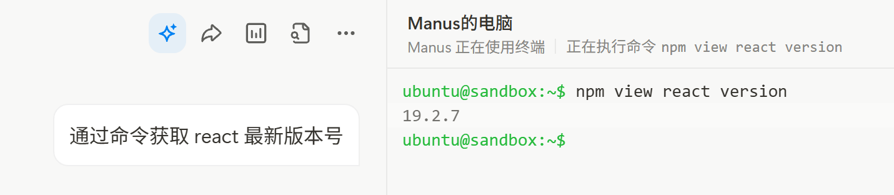

import { DemoShell } from '@/components/helper/demo-shell'
import { SandboxSimple } from '../demos/build-agent-6/sandbox-simple'
import { SandboxCode } from '../demos/build-agent-6/sandbox-code'
import { SandboxProgressive } from '../demos/build-agent-6/sandbox-progressive'
import { SandboxTerminal } from '../demos/build-agent-6/sandbox-terminal'

本篇介绍在 Agent 中集成沙箱，从而实现云端代码执行、文件处理等需求。

# 简易沙箱

网页版 Agent 有一个很大的缺陷：无法读写文件或执行代码。

不同于客户端 Agent，网页版 Agent 运行在云端，甚至可能是 Serverless，可用的资源有限；无论是系统资源、性能、安全等各个方面，都不适合提供沙箱服务。

因此，网页 Agent 通常接入第三方服务商提供的沙箱，通过 API 来发起操作。

---

常见的沙箱有 [E2B](https://e2b.dev/) 和 [Daytona](https://www.daytona.io/)，它们都是基于 Docker 镜像的；开发者预先构建好并上传镜像，然后通过 API 激活沙箱并与之通讯。

本文基于 [E2B](https://e2b.dev/) 沙箱。首先，到它的官网注册账号，免费用户每月有一定量的免费额度。

注册账号后，记下 API Key，通过环境变量配置到项目中：

```ini
AI_E2B_API_KEY = e2b_xxxx
```

然后，安装 E2B 的 SDK：

```bash
pnpm add e2b
```

这样，我们就能在代码中连接 E2B 沙箱，远程执行命令。

<br />

作为一个 Agent 开箱即用的沙箱，内部必然需要预装很多软件，不然用户随便某个需求，都需要现场安装，这样效率未免太低了。
首先，Python 和 Node.js 环境是必备的，同样 Git 也是必装的；其次，`curl`、`jq` 等工具也是必备的；此外，可能还需要预装一些给 Agent 使用的内部工具。

E2B 将基础镜像称之为 “模板 Template”。E2B 的一大特色就是既支持通过 Dockerfile 来创建模板，也支持通过 SDK 运行代码来创建。
如果我们的 Agent 不断更新加入新能力，此时通过 SDK 代码构建镜像的优势便体现出来：例如每个 Skill 都通过 YAML 的 FrontMatter 配置预装软件列表，此时可用代码对所有 Skill 进行扫描，提取出要安装的软件列表并构建相应的命令，这比起单纯使用 Dockerfile 来管理依赖来说灵活性强了太多。

E2B 提供了一个预装了各种环境的模板：`code-interpreter-v1`，可在它的 [GitHub 源码](https://github.com/e2b-dev/code-interpreter/blob/main/template/template.py) 查看预装的软件，我们直接基于这个模板进行定制即可。
在项目 `/scripts/sandbox.ts` 中，使用 E2B 的 SDK 初始化沙箱：

```typescript
import { dirname, resolve } from 'path'
import { fileURLToPath } from 'url'
import { defaultBuildLogger, Template } from 'e2b'

const currentDir = dirname(fileURLToPath(import.meta.url))

async function buildSandbox() {
  const template = Template({
    fileContextPath: resolve(currentDir, '../sandbox'),
    fileIgnorePatterns: [],
  })
    .fromTemplate('code-interpreter-v1')
    .runCmd('sudo apt-get update')
    .aptInstall(
      [
        'fonts-ipafont-gothic',
        'fonts-wqy-zenhei',
        'fonts-thai-tlwg',
        'fonts-kacst-one',
        'fonts-freefont-ttf',
        'fonts-noto-color-emoji',
      ],
      { noInstallRecommends: true }
    )
    .npmInstall('npm', { g: true })
    .npmInstall('yarn', { g: true })
    .npmInstall('pnpm', { g: true })

  const result = await Template.build(template, 'paper-agent-sandbox', {
    cpuCount: 2,
    memoryMB: 2048,
    skipCache: process.argv.includes('--skip-cache'),
    onBuildLogs: defaultBuildLogger(),
    apiKey: process.env.AI_E2B_API_KEY,
  })

  console.log(`E2B 镜像构建完成`)
  console.log(`模板名： ${result.name}`)
  console.log(`模板 ID： ${result.templateId}`)
}

buildSandbox()
```

代码中，通过 `../sandbox` 指定了上下文目录，因此，需要在项目根目录创建 `/sandbox/` 目录，但里面暂时还没有文件，因此可以放置一个 `.gitkeep` 或 `.gitignore` 来让目录能被 Git 记录；我们以后可能会在里面放置文件，现在还用不到。

这段模板为镜像安装了一系列中文字体，还安装了各种最新版本的 Node.js 包管理器。模板名称可以自行修改。沙箱的配置不需要太高，按照官方推荐的 2 核心 + 2GB 内存即可。

这是 TypeScript 代码，无法直接被 Node.js 执行，因此，还需要安装 `tsx` 或者 `ts-node` 来作为执行器：

```bash
pnpm add -D tsx dotenv
```

添加以下脚本到 `package.json` 中：

```json {3}
{
  "scripts": {
    "sandbox:build": "dotenv -c development -- tsx scripts/sandbox.ts"
  }
}
```

这样，以后只需要运行 `pnpm sandbox:build` 即可构建模板。

运行这段命令，构建模板成功后，控制台会打印模板 ID，把它放到环境变量：

```ini
AI_E2B_TEMPLATE_ID = xxxxxxx
```

这样，我们的沙箱模板就准备好了。后续如果需要调整预装软件，修改此文件，重新运行命令构建模板即可。

<br />

我们使用了 `code-interpreter-v1` 模板，这个模板集成了很多内置功能，E2B 的原始 SDK 是没有对接这些功能的，因此需要单独安装这个模板镜像的 SDK：

```bash
pnpm add @e2b/code-interpreter
```

接下来利用 SDK 实现后端。

<br />

首先，我们要连接到沙箱。E2B SDK 提供了 “创建新沙箱” 和 “根据 ID 连接到现有沙箱” 两种方式，显而易见，对于新会话我们可以创建沙箱，并记录下 ID 存储于会话上下文，而打开已有对话时，可以根据沙箱 ID 直接连接。

```typescript
import { Sandbox } from '@e2b/code-interpreter'

async function getSandbox() {
  // 从上下文中获取 sandboxId
  const sandbox = sandboxId
    ? await Sandbox.connect(cachedSandboxId, sandboxCreateOptions)
    : await Sandbox.create(process.env.AI_E2B_TEMPLATE_ID, sandboxCreateOptions)

  return sandbox
}
```

连接到沙箱后，便可以利用 SDK 进行一些远程操作：

```typescript
// 在沙箱中运行命令
const response = await sandbox.commands.run(command, { cwd: '/root' })

// 列出沙箱中某目录的文件
const files = await sandbox.files.list(path, { depth: 1 })

// 读取沙箱中某文件的内容
const content = await sandbox.files.read(path, { format: 'text' })

// 向沙箱写入文件
const result = await sandbox.files.write(path, content)
```

我们要把这些沙箱 SDK 操作包装为工具调用。

使用 Vercel AI SDK，将以上操作包装：

::: code-group

```typescript [运行命令]
import { CommandExitError } from '@e2b/code-interpreter'
import { tool } from 'ai'
import { z } from 'zod'

async function runCommand({ command, cwd }: { command: string, cwd?: string }) {
  const sandbox = await getSandbox()

  try {
    const result = await sandbox.commands.run(command, { cwd })

    return {
      exitCode: result.exitCode,
      ...(result.stdout ? { stdout: truncateText(result.stdout) } : {}),
      ...(result.stderr ? { stderr: truncateText(result.stderr) } : {}),
    }
  } catch (error) {
    if (error instanceof CommandExitError) {
      return {
        exitCode: error.exitCode,
        error: error.error,
        ...(error.stdout ? { stdout: truncateText(error.stdout) } : {}),
        ...(error.stderr ? { stderr: truncateText(error.stderr) } : {}),
      }
    }

    return {
      error: error instanceof Error ? error.message : '命令执行失败',
    }
  }
}

const command = tool({
  description: '在沙箱中执行 shell 命令。适合运行测试、安装依赖、执行脚本等。',
  inputSchema: z.object({
    command: z
      .string().trim().min(1)
      .describe('要执行的 shell 命令。'),
    cwd: z
      .string().trim().min(1).optional()
      .describe('命令工作目录。'),
    timeoutMs: z
      .int().min(1000).max(120000).optional().default(30000)
      .describe('命令超时时间，单位毫秒。'),
  }),
  execute: runCommand,
})
```

```typescript [运行命令]
import { tool } from 'ai'
import { pick } from 'lodash-es'
import { z } from 'zod'

const ls = tool({
  description: '列出沙箱中的目录内容。',
  inputSchema: z.object({
    path: z
      .string().trim().min(1).optional().default('.')
      .describe('要列出的目录路径，默认当前目录。'),
    depth: z
      .int().min(1).max(5).optional().default(1)
      .describe('递归列出的目录深度，默认 1。'),
  }),
  execute: async ({ path, depth }) => {
    try {
      const sandbox = await getSandbox()
      const entries = await sandbox.files.list(path, { depth })

      return { entries: entries.map(entry => pick(entry, ['name', 'path', 'type', 'size'])) }
    } catch (error) {
      return { error: error instanceof Error ? error.message : '目录读取失败' }
    }
  },
})
```

```typescript [读取文件]
import { tool } from 'ai'
import { z } from 'zod'

const read_file = tool({
  description: '读取沙箱中的文本文件。',
  inputSchema: z.object({
    path: z
      .string().trim().min(1)
      .describe('要读取的文件路径。'),
    maxLength: z
      .int().min(1000).max(100000).optional().default(1000)
      .describe('最大返回字符数。'),
  }),
  execute: async ({ path, maxLength }) => {
    try {
      const sandbox = await getSandbox()
      const content = await sandbox.files.read(path, { format: 'text' })

      return {
        // truncateText 是截取输出内容的函数
        content: truncateText(content, maxLength),
        truncated: content.length > maxLength,
      }
    } catch (error) {
      return { error: error instanceof Error ? error.message : '文件读取失败' }
    }
  },
})
```

```typescript [写入文件]
import { tool } from 'ai'
import { z } from 'zod'

const write_file = tool({
  description: '向沙箱写入文本文件。文件不存在时会创建，存在时会覆盖。',
  inputSchema: z.object({
    path: z.string().trim().min(1).describe('要写入的文件路径。'),
    content: z.string().describe('文件内容。'),
  }),
  execute: async ({ path, content }) => {
    try {
      const sandbox = await getSandbox()
      const info = await sandbox.files.write(path, content)

      return { path: info.path }
    } catch (error) {
      return { error: error instanceof Error ? error.message : '文件写入失败' }
    }
  },
})
```

```typescript [编辑文件]
import { tool } from 'ai'
import { z } from 'zod'

const edit_file = tool({
  description: '通过精确字符串替换编辑沙箱中的文本文件。',
  inputSchema: z.object({
    path: z.string().trim().min(1).describe('要编辑的文件路径。'),
    oldText: z.string().min(1).describe('文件中需要被替换的原始文本，必须精确匹配。'),
    newText: z.string().describe('替换后的新文本。'),
    replaceAll: z
      .boolean().optional().default(false)
      .describe('是否替换全部匹配项，默认只替换第一个。'),
  }),
  execute: async ({ path, oldText, newText, replaceAll }) => {
    try {
      const sandbox = await getSandbox()
      const content = await sandbox.files.read(path, { format: 'text' })
      const occurrences = content.split(oldText).length - 1

      if (occurrences === 0) {
        return { edited: false, error: '未找到要替换的原始文本' }
      }

      const nextContent = replaceAll
        ? content.replaceAll(oldText, newText)
        : content.replace(oldText, newText)

      const info = await sandbox.files.write(path, nextContent)

      return { path: info.path, edited: true, replacements: replaceAll ? occurrences : 1 }
    } catch (error) {
      return { edited: false, error: error instanceof Error ? error.message : '文件编辑失败' }
    }
  },
})
```

:::

为了增加 Agent 在沙箱中执行任务的效率，通常，还会提供 `glob` 和 `grep` 两个工具，用于从复杂的文件系统中按通配符快速筛选文件，或从多个文件中按照通配符快速查找内容：

::: code-group

```typescript [glob 工具]
import { tool } from 'ai'
import { z } from 'zod'

const glob = tool({
  description: '在沙箱中按 glob 模式查找文件路径。',
  inputSchema: z.object({
    pattern: z
      .string().trim().min(1)
      .describe('glob 模式，例如 **/*.ts。'),
    cwd: z
      .string().trim().min(1).optional().default('.')
      .describe('查找起始目录，默认当前目录。'),
    maxResults: z
      .int().min(1).max(500).optional().default(100)
      .describe('最多返回多少条结果。'),
  }),
  execute: async ({ pattern, cwd, maxResults }) => {
    const command = `rg --files -g ${shellQuote(pattern)} --no-ignore 2>/dev/null | sort | head -n ${maxResults}`
    // runCommand 的定义在 “执行命令” 工具中
    const result = await runCommand({ command, cwd })
    const stdout = 'stdout' in result ? (result.stdout ?? '') : ''
    const matches = stdout
      .split('\n')
      .map(line => line.trim())
      .filter(Boolean)
      .map(relativePath => ({ path: resolveSandboxPath(cwd, relativePath), relativePath }))

    return {
      matches,
      count: matches.length,
      ...('error' in result ? { error: result.error } : {}),
    }
  },
})
```

```typescript [grep 工具]
import { tool } from 'ai'
import { z } from 'zod'

const grep = tool({
  description: '在沙箱中使用 ripgrep 搜索文件内容。',
  inputSchema: z.object({
    pattern: z
      .string().trim().min(1)
      .describe('要搜索的文本或正则表达式。'),
    path: z
      .string().trim().min(1).optional().default('.')
      .describe('搜索目录或文件，默认当前目录。'),
    ignoreCase: z
      .boolean().optional().default(false)
      .describe('是否忽略大小写。'),
    maxResults: z
      .int().min(1).max(500).optional().default(100)
      .describe('最多返回多少条匹配结果。'),
  }),
  execute: async ({ pattern, path, ignoreCase, maxResults }) => {
    const flags = ignoreCase ? '-n -i' : '-n'
    const command = `rg ${flags} -m ${maxResults} -- ${shellQuote(pattern)} ${shellQuote(path)}`
    // runCommand 的定义在 “执行命令” 工具中
    const result = await runCommand({ command })
    const stdout = 'stdout' in result ? (result.stdout ?? '') : ''
    const matches = stdout
      .split('\n')
      .filter(Boolean)
      .map(line => {
        const match = /^(.*?):(\d+):(.*)$/.exec(line)

        if (!match) {
          return { path: '', lineNumber: 0, text: line }
        }

        return { path: match[1], lineNumber: Number(match[2]), text: match[3] }
      })

    return {
      matches,
      count: matches.length,
      ...('error' in result ? { error: result.error } : {}),
    }
  },
})
```

:::

这样以来，我们便将一系列沙箱操作包装为工具调用提供给 AI 大模型。

接下来，我们将这些工具加上系统提示词，提供给 AI SDK：

```typescript
import {
  convertToModelMessages,
  createUIMessageStreamResponse,
  stepCountIs,
  streamText,
  tool,
  toUIMessageStream,
  type UIMessage,
} from 'ai'

import { mainModel } from '@/lib/agent/models'

export async function POST(request: Request) {
  const { messages } = (await request.json()) as { messages: UIMessage[] }
  const modelMessage = await convertToModelMessages(messages)

  const command = tool({ /* 从上下文中获取沙箱，初始化工具 */ })
  // ls、read_file 等工具的实现，省略

  const result = streamText({
    model: mainModel,
    messages: modelMessage,
    system:
      '你可以使用沙箱工具读写文件、搜索文件和执行命令。沙箱是临时 Linux 环境，已安装 Python、Node.js、curl 等常用工具。执行命令前尽量先确认当前目录和文件结构。修改文件优先使用 write_file 或 edit_file，搜索文件优先使用 glob 或 grep。',
    tools: { command, ls, read_file, write_file, edit_file, glob, grep },
    stopWhen: stepCountIs(10),
  })

  return createUIMessageStreamResponse({
    stream: toUIMessageStream({ stream: result.stream }),
  })
}
```

这样一个支持沙箱的 Agent 后端便完成了。
接下来，补全这些工具调用的样式，在前端实现对应结果的渲染。

<br />

前端的实现和之前一样，在消息的 `message.parts` 中，依据 `part.type` 区分工具调用的类别，渲染不同的组件。简化过的写法是这样的：

```tsx
{messages.map((message, messageIndex) => (
  <Message from={message.role} key={message.id}>
    <MessageContent>
      {message.parts.map((part, index) => {
        switch (part.type) {
          case 'text':
            return (
              <MessageResponse key={`${message.id}-${index}`}>
                {part.text}
              </MessageResponse>
            )

          case 'tool-command':
            return <div>...</div>

          case 'tool-ls':
            return <div>...</div>

          // ... 补全各工具调用的渲染

          default:
            return null
        }
      })}
    </MessageContent>
  </Message>
))}
```

本 Demo 中，为了简化，使用默认的通用工具调用来演示。

这样便实现了沙箱。渲染组件如下：

<DemoShell rerender>
  <SandboxSimple />
</DemoShell>

使用对话框中预设的问题发送，可以看到 AI 直接调用沙箱，运行命令获取了准确的结果。
如果没有沙箱，这一步只能通过网络搜索，既不准确，又会浪费 Token。

# 支持代码执行

E2B 提供了预装环境的沙箱，可以直接运行 Python 或 Node.js 代码。

通过 SDK 可以直接传入代码运行，SDK 返回运行代码的产物；
调用方式如下：

```typescript
const execution = await sandbox.runCode(code, { timeoutMs: 30 * 1000 })
```

这里 `code` 是要执行的 Python 代码，`execution` 为运行实例，通过 `execution.results` 即可访问代码运行结果；它可能是一个数组，包含了代码运行的产物集合。

E2B 沙箱支持多种格式的代码运行产物，例如 JSON、HTML、图片格式。
因此，需要开发对应的前端组件，根据类型，渲染对应的产物。此外，还可以利用 SDK 提供的文件下载功能，将代码运行产物下载到服务器，然后通过服务器或上传对象存储，持久化存储代码运行产物，以便为用户归档。

渲染出的组件如下：

<DemoShell rerender>
  <SandboxCode />
</DemoShell>

# 懒加载沙箱

按照上面的逻辑，存在以下问题：

- 每个对话都要预备一个沙箱，开销太大；
- 多个沙箱专用工具存在于工具列表中，如果用户并不常用沙箱，把这一系列工具发给 AI 会浪费 Token、分散注意力。

因此，我们可以做出如下优化：

- 新会话不再预备沙箱，工具列表默认只提供 `init_sandbox` 工具，调用此工具后，才会初始化沙箱；
- 其它的例如 `command`、`ls` 等工具，默认也是不提供的，只有初始化沙箱后，才会对 AI 暴露。

首先，实现 `init_sandbox` 工具：

```typescript
import { tool } from 'ai'
import { z } from 'zod'

const init_sandbox = tool({
  description: '如有使用 Linux 沙箱的需求，例如读写文件、搜索文件或执行命令，使用此工具初始化沙箱。',
  inputSchema: z.object({}),
  execute: async () => {
    try {
      // 初始化沙箱，通常初始完沙箱后，可以在数据库中把会话标记为 “沙箱可用”，便于后续判断
      await prepareSandbox()
      return { sandbox_inited: true }
    } catch (error) {
      return {
        sandbox_inited: false,
        error: error instanceof Error ? error.message : '沙箱初始化失败',
      }
    }
  },
})
```

然后，根据当前是否已初始化沙箱，调整系统提示词和工具列表：

```typescript {37-48}
import {
  convertToModelMessages,
  createUIMessageStreamResponse,
  stepCountIs,
  streamText,
  tool,
  toUIMessageStream,
  type UIMessage,
  type ModelMessage,
} from 'ai'
import { pick } from 'lodash-es'
import { z } from 'zod'

import { mainModel } from '@/lib/agent/models'

// 示例代码是遍历之前的所有消息，检查 init_sandbox 工具调用
// 实际开发中，可以直接从数据库或 Redis 中甚至请求 body 里取值，不一定要遍历历史消息
function isSandboxInited(messages: ModelMessage[]) {
  return messages.some(message => {
    if (message.role !== 'tool') {
      return false
    }

    return message.content.some(
      part => part.type === 'tool-result' && part.toolName === 'init_sandbox'
    )
  })
}

export async function POST(request: Request) {
  const { messages } = (await request.json()) as { messages: UIMessage[] }
  const modelMessage = await convertToModelMessages(messages)

  const result = streamText({
    model: mainModel,
    messages: modelMessage,
    tools: sandboxTools,
    prepareStep: ({ messages }) => {
      // 判断沙箱是否已初始化
      const sandboxInited = isSandboxInited(messages)

      return {
        system: sandboxInited ? sandboxSystemPrompt : sandboxInitSystemPrompt,
        activeTools: sandboxInited
          ? (Object.keys(sandboxTools).filter(toolName => toolName !== 'init_sandbox') as any)
          : ['init_sandbox'],
      }
    },
    stopWhen: stepCountIs(10),
  })

  return createUIMessageStreamResponse({
    stream: toUIMessageStream({ stream: result.stream }),
  })
}
```

这里，`activeTools` 是 Vercel AI SDK 提供的过滤工具列表专用的参数。

注意，这里的 `isSandboxInited` 必须放在 `prepareStep` 中进行判断。
这是因为：**Vercel AI SDK 的 `streamText` 参数配置只对初始的消息输入有用；在一轮 Agent 对话循环中，后续步骤如果需要动态修改提示词、工具列表，必须通过 `prepareStep` 来修改。**

而前端甚至完全不用修改，因为只是多了个 `init_sandbox` 的工具调用类型，使用通用工具调用组件渲染即可。

<br />

经过上述修改，便可以实现 “懒加载” 的沙箱；在 AI 没有主动声明初始化沙箱之前，之前那些系统提示词和工具列表都不会暴露给 AI 大模型，从而减少 Token 浪费。

完整实现后，渲染的组件如下：

<DemoShell rerender>
  <SandboxProgressive />
</DemoShell>

把预设的提示词直接发送，可以看到多了一步 `init_sandbox` 工具调用，用以初始化沙箱；
如果再提问例如 “vue 的最新版本号是？”，再次触发工具调用，此时就不会再 `init_sandbox` 了，而是直接调用 `command` 执行命令。

# 模拟终端 + 流式输出

::: info Tips

这部分功能可以大幅提高用户体验，但实现较为复杂，且本文使用的方式不一定是最佳实践，仅供参考。

:::

上述示例中，可以通过 E2B 的 SDK 在沙箱中执行命令；运行方式也很简单，只要把要运行的命令通过 `sandbox.commands.run()` 传给沙箱，即可等待结果输出。

下图是 MiniMax Agent 的沙箱工具调用渲染：



可以看到，和我们上面的实例差不多。

然而，这种方式的体验并不好，因为：

- 输出是纯文本，缺少了 Linux 终端的 ANSI 高亮，观感很差；
- 在命令完成之前只能等待，执行完毕后一口气显示所有输出，不符合终端的逻辑。

因此，我们期望有一种方式，能够以 “保留 ANSI 高亮” 且 “流式地” 把终端输出传给用户。

<br />

下图是 Manus 的终端，它可以显示 ANSI 高亮，相比之下，体验更佳：



<br />

这是一个完整实现模拟终端 + 流式输出的沙箱 Agent，你可以使用预设的提问进行尝试：

<DemoShell rerender>
  <SandboxTerminal />
</DemoShell>

可以看到终端可以流式输出内容，还能保持真实终端中的文字颜色。

接下来介绍从开发者层面如何实现这种效果。

---

E2B 提供了另一种连接到沙箱的方式：`sandbox.pty`；
这种方式，可以创建或连接到沙箱的伪终端，此后便可以通过 `onData` 回调流式获取终端输出；而且，这种方式接收的终端输出会带有 ANSI 控制字符，可以通过一些解析工具，渲染出 ANSI 的效果。

首先，我们要根据 E2B 终端的特点，选择正确的用法：

1. 沙箱创建终端时，会得到一个 PID，后续可以使用相同的 PID 复用终端；但终端的有效时间很短，难以持久化；所以，推荐的做法是每次执行命令都新开一个终端；
2. 连接到终端后，便可以通过回调持续接收到沙箱中终端的输出，同时，也可以向终端中发送输入，约等于是建立了 “双向通讯”；
3. 执行完某个命令后，终端不会退出，还会继续保持连接并等待用户的后续输入，因此，我们要想办法判断命令的终止，手动销毁终端，避免浪费。

上面的 ① 和 ② 都不算问题，只有 ③ 需要解决。

> 上文中 Manus 沙箱的截图中可以看到，在执行完命令后，沙箱多输出了一行 `ubuntu@sandbox:~$`，因此我怀疑 Manus 的沙箱可以在进入空闲状态时发送一个信号告知 Agent，但 E2B 没有这个功能。

首先，需要对沙箱进行改造，使它满足 **“命令执行完成后，输出一段不可见控制字符”**，来让 Agent 提取输出以进行后续步骤。

在项目中创建文件 `/sandbox/command_complete.sh`，内容：

```bash
if [[ -n "${BASH_VERSION:-}" ]] && [[ "$-" == *i* ]]; then
  __command_complete() {
    local exit_code=$?

    if [[ -n "${__command_complete_sign:-}" ]]; then
      printf '\033]133;D;%s\007' "$exit_code"
    fi

    __command_complete_sign=1
  }

  if [[ ";${PROMPT_COMMAND:-};" != *";__command_complete;"* ]]; then
    PROMPT_COMMAND="__command_complete${PROMPT_COMMAND:+;$PROMPT_COMMAND}"
  fi
fi
```

这样以来，终端每次进入待命状态时，都会输出一个 `\u001b]133;D;` 这个特殊控制字符，后续只要监听这个字符即可。

修然后，编辑 `/scripts/sandbox.ts`，添加以下内容：

```typescript {28-31}
import { dirname, resolve } from 'path'
import { fileURLToPath } from 'url'
import { defaultBuildLogger, Template } from 'e2b'

const currentDir = dirname(fileURLToPath(import.meta.url))

async function buildSandbox() {
  const template = Template({
    fileContextPath: resolve(currentDir, '../sandbox'),
    fileIgnorePatterns: [],
  })
    .fromTemplate('code-interpreter-v1')
    .runCmd('sudo apt-get update')
    .aptInstall(
      [
        'fonts-ipafont-gothic',
        'fonts-wqy-zenhei',
        'fonts-thai-tlwg',
        'fonts-kacst-one',
        'fonts-freefont-ttf',
        'fonts-noto-color-emoji',
      ],
      { noInstallRecommends: true }
    )
    .npmInstall('npm', { g: true })
    .npmInstall('yarn', { g: true })
    .npmInstall('pnpm', { g: true })
    .copy('command_complete.sh', '/tmp/')
    .runCmd(
      'sudo bash -lc "printf \'\\n\' >> /etc/bash.bashrc && cat /tmp/command_complete.sh >> /etc/bash.bashrc"'
    )

  const result = await Template.build(template, 'paper-agent-sandbox', {
    cpuCount: 2,
    memoryMB: 2048,
    skipCache: process.argv.includes('--skip-cache'),
    onBuildLogs: defaultBuildLogger(),
    apiKey: process.env.AI_E2B_API_KEY,
  })

  console.log(`E2B 镜像构建完成`)
  console.log(`模板名： ${result.name}`)
  console.log(`模板 ID： ${result.templateId}`)
}

buildSandbox()
```

这样，刚才新建文件的内容就会被写入到 Bash 的配置文件中，使它生效。

修改后，记得运行 `pnpm sandbox:build`，重新构建镜像即可。

<br />

然后，我们基于 `getSandbox` 封装一个 `getTerminal`：

```typescript
export async function getTerminal({
  cwd,
  onData,
}: {
  cwd?: string
  onData: (data: Uint8Array) => void | Promise<void>
}) {
  const sandbox = await getSandbox()
  const terminal = await sandbox.pty.create({ cwd, onData, rows: 40, cols: 140 })

  return { sandbox, terminal }
}
```

每次需要使用终端，都创建一个新的 PTY，列数为 120，行数为 40。

这里，`onData` 就是终端输出数据时的回调，但它的回调参数并不是字符串，而是 `Uint8Array`，因此需要使用 `TextDecoder` 进行转码，转为字符串。
E2B 官网文档给出了转码的示例：

```typescript
const decoder = new TextDecoder()

const { sandbox, terminal } = await getTerminal({
  onData: data => {
    const text = decoder.decode(data, { stream: true })
  	if (!text) {
      return
    }
    // 后续处理逻辑 ...
  },
})
```

这里的 `text` 即是转出的字符串结果。

接下来，我们要把本次输出的文本加上之前的输出文本，进行一次统一判断，判断是否要输出可见字符，以及判断是否终止终端输出。
这里，我们定义一个用于判断的函数，代码如下：

```typescript
export function parseTerminalOutputBuffer(
  buffer: string,
  keepMarkerTail = true
): {
  completed: boolean
  exitCode?: number
  nextBuffer: string
  visibleText: string
} {
  const commandDoneMarkerPrefix = '\u001b]133;D;'

  let nextBuffer = buffer
  let visibleText = ''

  while (nextBuffer) {
    const markerIndex = nextBuffer.indexOf(commandDoneMarkerPrefix)

    if (markerIndex < 0) {
      let prefixSuffixLength = 0

      if (keepMarkerTail) {
        const maxLength = Math.min(nextBuffer.length, commandDoneMarkerPrefix.length - 1)

        for (let length = maxLength; length > 0; length -= 1) {
          if (nextBuffer.endsWith(commandDoneMarkerPrefix.slice(0, length))) {
            prefixSuffixLength = length
            break
          }
        }
      }

      const safeLength = nextBuffer.length - prefixSuffixLength

      if (safeLength > 0) {
        visibleText += nextBuffer.slice(0, safeLength)
        nextBuffer = nextBuffer.slice(safeLength)
      }

      return { completed: false, nextBuffer, visibleText }
    }

    visibleText += nextBuffer.slice(0, markerIndex)
    nextBuffer = nextBuffer.slice(markerIndex + commandDoneMarkerPrefix.length)

    const terminatorMatch = /^(-?\d+)(\u0007|\u001b\\)/.exec(nextBuffer)
    if (!terminatorMatch) {
      nextBuffer = `${commandDoneMarkerPrefix}${nextBuffer}`
      return { completed: false, nextBuffer, visibleText }
    }

    return { completed: true, exitCode: Number(terminatorMatch[1]), nextBuffer: '', visibleText }
  }

  return { completed: false, nextBuffer, visibleText }
}
```

这个函数接收需要解析的字符串 Buffer，进行一系列处理后返回以下结果：

- 使用上文中在沙箱中定义好的结束标志码来作为终止输出的标记，一旦匹配上，表明可以终止终端的输出了，此时返回值便会包含 `completed: true`；
  还会提取出退出码，以 `exitCode` 字段返回；
- 从 Buffer 中滤出用户不可见字符串，最终返回的 `visibleText` 字段中只包含用户可见字符串；
- 如果本次无法处理尾部数据，表明还需要等待下一段输入传入，此时把未解析的部分通过 `nextBuffer` 字段返回。

我们每次得到一次 `onData` 回调的数据输入后，先经过 `TextDecoder` 处理，然后和之前处理得到的 `nextBuffer` 相加，并交给 `parseTerminalOutputBuffer` 函数处理。
处理完成后，如果还有残留 `nextBuffer`，那么要找个变量承接它，准备和下一次 `onData` 传入的数据拼接起来再一同处理。

用伪代码的形式来理解，大约是这样：

```typescript {1-2,13-16}
// 之前剩余的待解析文本
let nextBuffer = ''

const decoder = new TextDecoder()

const { sandbox, terminal } = await getTerminal({
  onData: data => {
    const text = decoder.decode(data, { stream: true })
  	if (!text) {
      return
    }

    // 使用 nextBuffer + 本轮解析出的最新文本，参与解析
    const parsedResult = parseTerminalOutputBuffer(outputBuffer + text, true)
    // nextBuffer 为剩余内容，赋值给 nextBuffer 准备给下一轮
    nextBuffer = parsedResult.nextBuffer

    // 后续处理流程...
  },
})
```

后续处理流程，会根据得到解析的结果 `parsedResult` 进行以下动作：

- 把终端输出的字符 `visibleText` 传给前端渲染；
- 监听终端输出的终止动作。

我们分别来将这两个操作是如何做的。

<br />

**① 把终端输出的字符 `visibleText` 传给前端渲染：**

下面是 Vercel AI SDK 向前端流式输出自定义数据的方式：

```typescript {18,22}
import {
  convertToModelMessages,
  createUIMessageStream,
  createUIMessageStreamResponse,
  stepCountIs,
  streamText,
  toUIMessageStream,
  UIMessage,
  UIMessageStreamWriter,
} from 'ai'

import { mainModel } from '@/lib/agent/models'

async function POST(request: Request) {
  const { messages } = (await request.json()) as { messages: UIMessage[] }
  const modelMessage = await convertToModelMessages(messages)

  let uiWriter: UIMessageStreamWriter<UIMessage> | undefined

  const stream = createUIMessageStream<UIMessage>({
    execute: async ({ writer }) => {
      uiWriter = writer

      const result = streamText({
        model: mainModel,
        messages: modelMessage,
        stopWhen: stepCountIs(10),
      })

      writer.merge(toUIMessageStream({ stream: result.stream }))
		},
	})

	return createUIMessageStreamResponse({ stream })
}
```

我们可以在代码中，通过 `uiWriter?.write()` 的方式来向前端推流，输出任意内容给 Agent 的前端组件：

```typescript
uiWriter?.write({
  // 事件名称，可以自己定义，前端组件需要保持一致
  type: 'data-terminal-stream',
  data: {
    stream: 'stdout'
    // 要推给前端的文本
    text: parsedResult.visibleText,
    // 本次终端命令的工具调用 ID，定义工具时可以拿到
    toolCallId,
  },
})
```

这样即可在每次解析出终端输出的字符串时，推给前端，并在前端组件上流式显示。

<br />

**② 监听终端输出的终止动作：**

这一步很简单，但是，我们面临一个代码开发中的任务流控制问题。

因为一次命令执行的流程大约是这样：大模型准备好命令 → 调用 `command` 工具将命令发送给沙箱 → 等待 `await` 沙箱执行完成的结果 → 结果发给大模型进行下一轮交互；
而我们以上所有代码，都属于 `command` 这个工具的代码，且大部分内容都处于沙箱 SDK 的 `onData` 回调中，我们面临一个 “先创建一个 `Promise`，并使它被 `await` 等待着，在回调中的某个时机将它 resolve” 这种情况。

ECMA 2024 提供了一个新的用法：

```typescript
const { promise, resolve, reject } = Promise.withResolvers()
```

这个用法可以同时获取一个 `Promise`、一个 “resolve” 方法和一个 “reject” 方法；
此 API 的加入，对于我们这种特殊的控制流需求而言非常适配，推荐使用。

对于上述开发需求，伪代码大致如下：

```typescript {1,9,23}
const { promise, resolve, reject } = Promise.withResolvers<number>()

const { sandbox, terminal } = await getTerminal({
  onData: data => {
    // ...
    const parsedResult = parseTerminalOutputBuffer(outputBuffer + text, true)
    // 如果解析出的终端输出，已终止，则完成这个 Promise
    if (parsedResult.completed) {
      resolve(parsedResult.exitCode)
    }
  },
})

// 使用 getTerminal() 返回的 sandbox 创建 PTY
await sandbox.pty.sendInput(
  // 使用 getTerminal() 返回的 terminal 的 PID
  terminal.pid,
  // 输入命令后，还需要按一下 “回车键”，因此添加一个 "\n"
  new TextEncoder().encode(command + '\n')
)

// 终端输出终止，得到结果
const exitCode = await promise

// 进行后续流程...
```

<br />

接下来实现前端组件。

Vercel AI SDK 在 `useMessage` 中同样提供了 `onData` 回调，用于监听来自后端的用户自定义消息推送。

代码如下：

```tsx
import { useChat } from '@ai-sdk/react'
import {
  DefaultChatTransport,
  isDataUIPart,
  UIMessage,
} from 'ai'

function Chat() {
  const { error, messages, sendMessage, status, stop } = useChat<UIMessage>({
    messages: [],
    transport: new DefaultChatTransport<UIMessage>(/* ... */),
    onData: part => {
      if (!isDataUIPart(part) && part.type === 'data-terminal-stream') {
        // part.data.text 就是收到的消息
      	// 后续步骤 ...
      }
    },
  })

  // ...
}
```

常见的设计是，终端是会话级的，整个会话共享同一个终端，此处可以使用 `useState` 持久化终端的内容，也可以使用 “发布-订阅” 模式，由终端组件来接收和处理状态。

本文的示例采用每次调用终端后，渲染一个终端组件，渲染当次执行的过程和结果，因此还需要根据 `toolCallId` 进行区分，避免组件收到了错误的数据流。

终端的文本渲染，需要处理 ANSI 文本，使用以下函数处理：

```typescript
function sanitizeTerminalOutput(output: string) {
  return output
    .replace(/\u001B\][^\u0007\u001B]*(?:\u0007|\u001B\\)/g, '')
    .replace(/\u001B[P^_X][\s\S]*?\u001B\\/g, '')
    .replace(/\u001B\[[0-?]*[ -/]*([@-~])/g, (sequence, command: string) =>
      command === 'm' ? sequence : ''
    )
    .replace(/[\u0000-\u0008\u000B-\u001A\u001C-\u001F\u007F]/g, '')
}
```

然后使用 `ansi-to-react` 的 `Ansi` 组件，对文本进行渲染。
Vercel AI Element 组件中已经包含此组件，且包含了一些终端渲染的模板代码，只需少许更改即可应用。
